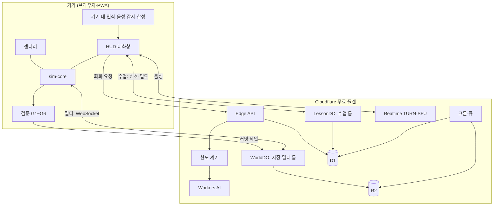

# 02. 구조 — 무료 인프라에서 돌리기

## 1. 원칙

1. **한도를 넘으면 과금이 아니라 기능 저하.** 무료 플랜은 한도 초과 시 해당 작업이 실패합니다. 모든 서버 호출 앞에 한도 계기를 두고, 실패하기 전에 스스로 낮은 단계로 내려갑니다.
2. **싱글은 서버 없이.** 싱글 월드의 시뮬레이션은 전부 기기에서 돕니다. 서버에는 저장과 회화 요청만 갑니다.
3. **월드마다 저장 창구는 하나.** 월드 하나당 Durable Object 하나가 유일한 기록자입니다. 동시 쓰기로 월드가 깨질 여지를 구조적으로 없앱니다.
4. **LLM 없이도 돈다.** 필수 거래는 문장 뱅크로 처리합니다. AI가 꺼져도 게임은 계속됩니다.
5. **아이 데이터는 밖으로 내보내지 않는다.** 음성은 기기에서 인식하는 것이 기본이고, 서버로 가더라도 식별 정보 없이 가며, 외부 LLM 사업자에게는 보내지 않습니다.

## 2. 기술 스택

| 계층 | 선택 | 비고 |
|---|---|---|
| 클라이언트 | TypeScript, Vite, Three.js(WebGL2), React(HUD는 DOM 오버레이), PWA | 설치 없이 링크로 실행 |
| 게임 로직 | `sim-core` 패키지(결정론), ECS(bitecs), Web Worker(월드젠·메싱·조명) | 클라이언트와 서버가 같은 규칙 코드 |
| 정적 호스팅 | Workers 정적 자산 | 정적 요청은 무료·무제한 |
| API | Workers + Hono | 호출당 CPU 10ms 예산 |
| 월드 저장·멀티 룸 | Durable Object(SQLite) `WorldDO` | 월드당 1개 |
| 수업 룸 | Durable Object `LessonDO` | 신호 교환, 대화 밀도 집계 |
| 공용 DB | D1 | 계정, 좌석, 지표, 리포트, 서버 목록 |
| 파일 | R2 | 음성 클립, 스냅샷, 쇼룸, 사전 합성 음성 |
| 실시간 음성 | WebRTC + Cloudflare Realtime(TURN·SFU) | 수업 창문, 초대 월드 음성 |
| AI | Workers AI(Whisper, 소형 LLM) | 일 10,000 뉴런 |
| 기기 내 AI | Whisper 소형(WebGPU), 음성 활동 감지, 브라우저 음성 합성 | 비용 0 |
| 예약 작업 | Cron Trigger 3개, Queues | 무료 플랜은 크론 5개까지 |
| 로그인 | 카카오·구글 OAuth(보호자·성인), 기기 연결 코드(아이 프로필) | 비밀번호와 메일 발송이 필요 없음 |
| 알림 | 웹 푸시, 리포트 링크 복사(메신저 공유) | 비용 0. 알림톡은 나중에 |
| 오류 수집 | Workers Logs, 클라이언트 오류 수집 엔드포인트 | |

## 3. 구조도



## 4. 무료 한도와 수용량

| 자원 | 무료 한도 | 이 설계의 사용량(`가정`) | 감당 범위 |
|---|---|---|---|
| DO 가동 시간 | 일 13,000 GB-s | 멀티·수업 룸이 깨어 있는 시간 × 0.128GB | 룸 가동 합계 하루 약 28시간 |
| DO 요청 | 일 10만 | 수업 2인, 초당 4회 전송, 2시간 = 57,600 메시지 | 수업 1회는 최악 계산으로도 한도 내. 요금 계산에는 수신 메시지 20개를 1요청으로 치는 규칙이 있으나 무료 한도에 같은 규칙이 적용되는지는 확인 필요 |
| Workers 요청 | 일 10만 | 회화 요청 + 저장 + 대시보드 | 활성 사용자 수백 명 수준까지 |
| Workers AI | 일 10,000 뉴런 | 수업 1회 약 2,160(서버 인식 25분 + LLM 60회) | 수업 하루 4회분, 또는 일반 사용 18시간분(서버 인식), 60시간분(기기 인식) |
| D1 쓰기 | 일 10만 행 | 발화 1건당 약 3행 | 발화 3만 건 |
| R2 | 10GB | 수업 원본 2시간 2채널 약 29MB | 원본 30일 보관 + 클립 영구 보관으로 수년 |
| Realtime | 월 1,000GB | 청취 1시간 약 0.014GB | 사실상 무제한 |

첫 유료 단계는 Workers 유료 플랜(월 5달러)입니다. 좌석 한 개 값으로 덮입니다. 그 뒤로는 사용자 1시간당 AI 비용이 서버 인식 기준 약 8원, 기기 인식 기준 약 3원입니다(`가정`).

**멀티 확장 수단**: 동시 룸이 많아지면 위치·애니메이션 동기화를 WebRTC 데이터 채널(P2P)로 옮기고, `WorldDO`는 블록·소지품·대화 결과 같은 권위 이벤트만 받습니다. 초기에는 `WorldDO` 중계만으로 충분합니다.

## 5. 한도 계기와 강등 사다리

`packages/quota`가 일일 카운터(뉴런, DO 요청, D1 쓰기)를 관리합니다. 카운터는 `QuotaDO` 하나에 모읍니다.

| 단계 | 조건 | 동작 |
|---|---|---|
| 0 | 사용률 70% 미만 | 정상 |
| 1 | 70% 이상 | 일반 사용자의 창작 AI를 뱅크 대체로 전환. 수업 룸은 정상 |
| 2 | 85% 이상 | 서버 인식을 수업 룸과 기기 인식 불가 사용자에게만 허용 |
| 3 | 95% 이상 | AI 제작 중지, 뱅크 전용. 운영자에게 푸시 |
| 4 | 공급 장애 | 뱅크 전용 모드. 게임은 계속 진행 |

수업 예약 시간 30분 전부터는 수업 몫(3,000 뉴런)을 따로 떼어 둡니다.

## 6. AI 사용 원칙

| 용도 | 사용 | 사용하지 않는 것과 이유 |
|---|---|---|
| 런타임 음성 인식 | 기기 내 Whisper → Workers AI Whisper | 브라우저 내장 인식(미성년 경로): 음성이 브라우저 제조사로 갈 수 있음 |
| 런타임 문장·제작 | 문장 뱅크 → 정확 일치 캐시 → Workers AI 소형 LLM | Gemini API: 약관상 미성년 이용 서비스에 사용 불가. 구독 계정: 런타임 호출 불가 |
| 런타임 음성 합성 | 사전 합성 파일 → 브라우저 음성 합성 | 유료 합성 API |
| 콘텐츠 초안(문장 뱅크, 사전, 번역) | 개발자가 Claude·Gemini 구독으로 대화형 생성 → 검증기 | 아이 데이터는 넣지 않음 |
| 음성 사전 합성 | 로컬 오픈소스 합성기, 또는 AWS 크레딧으로 일회성 배치 | AWS 상시 호스팅: 무료 플랜 계정은 6개월 뒤 닫힘 |

LLM에 보내는 것은 정규화된 문장, 맥락, 레벨, 허용 목록뿐입니다. 계정 식별자, 이름, 음성 원본은 보내지 않습니다.

## 7. 저장소 구조

```text
/apps
  /client        게임 클라이언트 (Vite, Three.js, React HUD, PWA)
  /edge          Workers: API, WorldDO, LessonDO, QuotaDO, 크론
  /web           소개 페이지, 학부모 대시보드, 교사 콘솔, 쇼룸 (정적 + API)
/packages
  /sim-core      결정론 규칙: 월드젠, 복셀, 게이지, 전투, 경제
  /converse      회화 상태 머신, 정규화, 파서, 채점, 레벨
  /guard         AI 명세 검문 G1~G8, 불변식, 저널
  /destruction   파괴·유체·투사체 커널 (reference/destruction 에서 이식)
  /schemas       zod 스키마: 명세·메시지·이벤트 (단일 출처)
  /quota         한도 계기, 강등 사다리
  /metrics       발화 지표 계산 (클라이언트와 서버 공용)
  /content       바이옴 팩, 블록·부품·의상 레지스트리, 언어 팩
  /ui            디자인 토큰, HUD·대시보드 컴포넌트
  /bots          헤드리스 플레이 봇
/tools           콘텐츠 검증기, 음성 사전 합성, 스냅샷 점검
/docs            이 스펙 팩
AGENTS.md
```

## 8. 권위 분담

| 대상 | 싱글 월드 | 멀티 월드 |
|---|---|---|
| 이동·카메라 | 기기 | 기기(속도·고도 상한만 룸이 검사) |
| 블록 편집 | 기기 → `WorldDO`에 묶음 저장 | 기기 예측 → 룸 확정 |
| 코인·소지품 | `WorldDO` 장부 | `WorldDO` 장부 |
| 별 등급·보상 | Edge API가 재채점 | Edge API가 재채점 |
| AI 명세·개체 커밋 | 기기 검문 후 `WorldDO` 경량 재검문 | 같음 |
| 월드 시간 | 기기(소유자 접속 중에만 진행) | 룸 |

## 9. 데이터 모델

### 9.1 D1 (공용, JSON은 text 열에 저장)

```sql
create table families     (id text primary key, created_at integer);
create table guardians    (id text primary key, family_id text, oauth_sub text unique, locale text);
create table players      (id text primary key, family_id text, kind text,            -- child | adult
                           nickname text, birth_year integer, l1 text, target_lang text,
                           level text, level_locked integer, tutor_student integer default 0);
create table consents     (player_id text, guardian_id text, scope text,              -- voice_store | lesson_window | showroom | public_servers
                           granted_at integer, revoked_at integer, primary key (player_id, scope));
create table seats        (id text primary key, payer_id text, player_id text, plan text,  -- solo | duo | addon | tutor
                           period text, starts_at integer, ends_at integer, status text);
create table guest_passes (id text primary key, seat_id text, code text unique, used_by text, expires_at integer);
create table friends      (a text, b text, approved_by_guardian integer, primary key (a, b));

create table worlds       (id text primary key, owner_id text, name text, seed text, gen_version integer,
                           mode text, lang text, visibility text,                     -- private | invite | public
                           pvp integer, max_players integer, archived integer, last_played integer);
create table world_members(world_id text, player_id text, role text, primary key (world_id, player_id));
create table server_list  (world_id text primary key, title text, tags text, audience text,  -- everyone | adults
                           online integer, updated_at integer);

create table utterances   (id text primary key, player_id text, world_id text, session_id text,
                           session_kind text,                                          -- solo | multi | lesson
                           ctx text, mode text,                                        -- free | guided | read | recall
                           interlocutor text,                                          -- npc | teacher | peer | self
                           first_text text, target_text text, final_text text,
                           words integer, l1_words integer, dur_ms integer, latency_ms integer,
                           stars integer, hint_level text, attempts integer, score real,
                           source text, audio_first text, audio_final text, created_at integer);
create table memory_cards (id text primary key, player_id text, utterance_id text, item_id text,
                           origin text,                                                -- play | lesson
                           box integer, next_review_at integer, lapses integer, mastered_at integer);
create table expressions  (id text primary key, player_id text, lemma_key text, first_seen_at integer,
                           born_in text,                                               -- lesson | solo
                           lesson_id text, reuse_solo integer default 0, last_used_at integer);

create table lessons      (id text primary key, player_id text, world_id text, started_at integer, ended_at integer,
                           plan text, campaign_note text);
create table lesson_minutes(lesson_id text, minute integer, student_ms integer, teacher_ms integer,
                           exchanges integer, activity text, primary key (lesson_id, minute));
create table pins         (id text primary key, lesson_id text, at_ms integer, kind text, note text,
                           before_clip text, after_clip text);
create table anchor_tasks (id text primary key, lesson_id text, prompt_id text, utterance_ids text, metrics text);

create table metrics_weekly(player_id text, week text, m text, primary key (player_id, week));
create table reports      (id text primary key, player_id text, kind text, ref_id text, facts text, body text,
                           clips text, share_token text, opened_at integer, created_at integer);
create table phrase_bank  (id text primary key, lang text, ctx text, intent text, slots_key text, level text,
                           offers text, tts text, status text);
create table cache_entries(key_hash text primary key, lang text, offers text, status text,
                           distinct_users integer, created_at integer);
create table quota_daily  (day text, k text, used integer, primary key (day, k));
```

### 9.2 WorldDO 내부 SQLite (월드당)

```sql
create table meta      (k text primary key, v text);              -- seed, gen_version, layout, schema_version, clock
create table chunks    (cx integer, cy integer, cz integer, rev integer, data blob,
                        primary key (cx, cy, cz));                -- L2 플레이어 편집 델타
create table objects   (id text primary key, kind text, spec text, spec_version integer,
                        owner text, state text,                   -- active | quarantined | removed
                        pos text, created_at integer);            -- L3 개체: 가구·주민·반려·의뢰·구역 규칙 (블록 없음)
create table items     (id text primary key, owner text, spec text, location text, durability integer, card_id text);
create table ledger    (id integer primary key autoincrement, player text, delta integer, reason text, ref text, at integer);
create table journal   (seq integer primary key autoincrement, at integer, actor text, op text, payload text, inverse text);
create table snapshots (id text primary key, at integer, reason text, r2_key text, journal_seq integer);
```

### 9.3 월드 룸 메시지

| 방향 | 메시지 | 내용 |
|---|---|---|
| C → S | `move` | 위치·속도·자세. 변화가 있을 때만, 초당 최대 4회 |
| C → S | `block.edit` | 좌표, 블록 ID, 예측 순번 (묶음 전송) |
| C → S | `use.slot` | 슬롯 번호, 대상 |
| C → S | `combat.hit` | 대상, 무기, 시각 |
| C → S | `object.propose` | 검문을 통과한 AI 명세와 검문 요약 |
| C → S | `say` | 말풍선 문장(인식·필터 통과분) |
| S → C | `snapshot` | 플레이어 상태, 시간, 날씨 (초당 4회) |
| S → C | `block.confirm` / `block.reject` | 확정 또는 롤백 |
| S → C | `inventory.patch`, `ledger.patch` | 서버 권위 변경분 |
| S → C | `object.commit` / `object.reject` | 개체 커밋 결과 |
| S → C | `event` | 사이렌, 소환, 복습 징후, 디렉터 이벤트 |

## 10. 개인정보 처리 흐름

| 데이터 | 저장 조건 | 보관 | 접근 |
|---|---|---|---|
| 발화 전사문·지표 | 좌석 보유 | 좌석 유지 기간 + 12개월(`가정`) | 본인, 보호자, (과외 학생) 교사 |
| 발화 음성 클립 | 보호자의 `voice_store` 동의 | 위와 같음 | 서명 URL로만 |
| 수업 원본 녹음 | 과외 학생, `voice_store` 동의 | 30일 뒤 삭제, 하이라이트 클립만 유지 | 보호자, 교사 |
| 수업 실시간 음성 | `lesson_window` 동의 | 저장 안 함(스트림) | 보호자 |
| 게스트 음성 | 저장 안 함 | 없음 | 없음 |
| 쇼룸 | `showroom` 동의 | 철회 시 삭제 | 링크 보유자 |

미성년 좌석은 보호자 계정 아래에서만 만들어집니다. 동의 철회는 대시보드에서 즉시 반영되고 해당 음성은 7일 유예 후 삭제됩니다.
