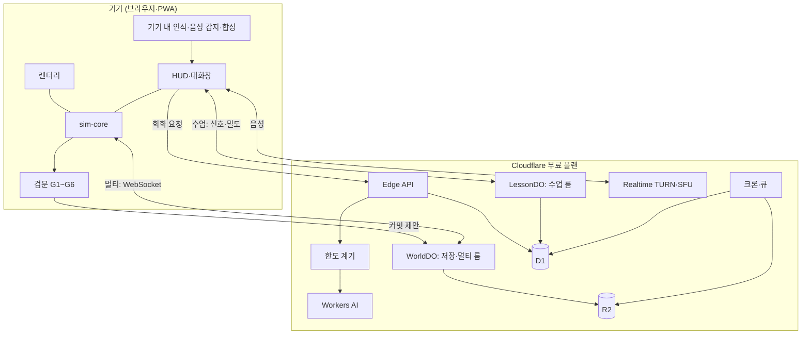

# 02. 구조 — 무료 인프라에서 돌리기

## 1. 원칙

1. **한도를 넘으면 과금이 아니라 기능 저하.** 무료 플랜은 한도 초과 시 해당 작업이 실패합니다. 모든 서버 호출 앞에 한도 계기를 두고, 실패하기 전에 스스로 낮은 단계로 내려갑니다.
2. **싱글은 서버 없이.** 싱글 월드의 시뮬레이션은 전부 기기에서 돕니다. 서버에는 저장과 회화 요청만 갑니다.
3. **월드마다 저장 창구는 하나.** 월드 하나당 Durable Object 하나가 유일한 기록자입니다. 동시 쓰기로 월드가 깨질 여지를 구조적으로 없앱니다.
4. **LLM 없이도 돈다.** 필수 거래는 문장 뱅크로 처리합니다. AI가 꺼져도 게임은 계속됩니다.
5. **아이 데이터는 밖으로 내보내지 않는다.** 음성은 기기에서 인식하는 것이 기본이고, 서버로 가더라도 식별 정보 없이 가며, 외부 LLM 사업자에게는 보내지 않습니다.

## 2. 기술 스택

| 계층 | 선택 | 비고 |
|---|---|---|
| 클라이언트 | TypeScript, Vite, Three.js(WebGL2), React(HUD는 DOM 오버레이), PWA | 설치 없이 링크로 실행 |
| 게임 로직 | `sim-core` 패키지(결정론), ECS(bitecs), Web Worker(월드젠·메싱·조명) | 클라이언트와 서버가 같은 규칙 코드 |
| 정적 호스팅 | Workers 정적 자산 | 정적 요청은 무료·무제한 |
| API | Workers + Hono | 호출당 CPU 10ms 예산 |
| 월드 저장·멀티 룸 | Durable Object(SQLite) `WorldDO` | 월드당 1개 |
| 수업 룸 | Durable Object `LessonDO` | 신호 교환, 대화 밀도 집계 |
| 공용 DB | D1 | 계정, 좌석, 지표, 리포트, 서버 목록 |
| 파일 | R2 | 음성 클립, 스냅샷, 쇼룸, 사전 합성 음성 |
| 실시간 음성 | WebRTC + Cloudflare Realtime(TURN·SFU) | 수업 창문, 초대 월드 음성 |
| AI | Workers AI(Whisper, 소형 LLM) | 일 10,000 뉴런 |
| 기기 내 AI | Whisper 소형(WebGPU), 음성 활동 감지, 브라우저 음성 합성 | 비용 0 |
| 예약 작업 | Cron Trigger 3개, Queues | 무료 플랜은 크론 5개까지 |
| 로그인 | 카카오·구글 OAuth(보호자·성인, `apps/edge/src/oauth.ts` 공용: 제공자·PKCE·state 쿠키·nonce·ID 토큰 검증·계정 연결, 역할별 핸들러 = 보호자 `guardian-oauth.ts`·교사 `operator-login.ts`), 가족 초대 링크, 기기 연결 코드(아이 프로필) | 비밀번호와 메일 발송이 필요 없음. 설정 없는 제공자는 버튼이 숨음 |
| 알림 | 웹 푸시(`push.ts`·`web-push.ts`, VAPID 키는 DO 안에서 생성, 발송 스위치는 운영자), 리포트 링크 복사(메신저 공유) | 비용 0. 알림톡은 나중에 |
| 오류 수집 | Workers Logs, 클라이언트 오류 수집 엔드포인트 | |

## 3. 구조도



## 4. 무료 한도와 수용량

| 자원 | 무료 한도 | 이 설계의 사용량(`가정`) | 감당 범위 |
|---|---|---|---|
| DO 가동 시간 | 일 13,000 GB-s | 멀티·수업 룸이 깨어 있는 시간 × 0.128GB | 룸 가동 합계 하루 약 28시간 |
| DO 요청 | 일 10만 | 받은 자세 글 1개 = 호출 1회(운영 실측, 유지 신호는 0). 자세 예산은 사람당 평균 초당 1.2 이하 | 8명 × 2시간을 최악(내내 예산 상한)으로 쳐도 69,120. 실측과 계산은 11.3절 |
| Workers 요청 | 일 10만 | 회화 요청 + 저장 + 대시보드 | 활성 사용자 수백 명 수준까지 |
| Workers AI | 일 10,000 뉴런 | 수업 1회 약 2,160(서버 인식 25분 + LLM 60회) | 수업 하루 4회분, 또는 일반 사용 18시간분(서버 인식), 60시간분(기기 인식) |
| D1 쓰기 | 일 10만 행 | 발화 1건당 약 3행 | 발화 3만 건 |
| R2 | 10GB | 수업 원본 2시간 2채널 약 29MB | 원본 30일 보관 + 클립 영구 보관으로 수년 |
| Realtime | 월 1,000GB | 청취 1시간 약 0.014GB | 사실상 무제한 |

첫 유료 단계는 Workers 유료 플랜(월 5달러)입니다. 좌석 한 개 값으로 덮입니다. 그 뒤로는 사용자 1시간당 AI 비용이 서버 인식 기준 약 8원, 기기 인식 기준 약 3원입니다(`가정`).

**멀티 확장 수단**: 동시 룸이 많아지면 위치·애니메이션 동기화를 WebRTC 데이터 채널(P2P)로 옮기고, `WorldDO`는 블록·소지품·대화 결과 같은 권위 이벤트만 받습니다. 초기에는 `WorldDO` 중계만으로 충분합니다.

## 5. 한도 계기와 강등 사다리

`packages/quota`가 일일 카운터(뉴런, DO 요청, D1 쓰기)를 관리합니다. 카운터는 `QuotaDO` 하나에 모읍니다.

| 단계 | 조건 | 동작 |
|---|---|---|
| 0 | 사용률 70% 미만 | 정상 |
| 1 | 70% 이상 | 일반 사용자의 창작 AI를 뱅크 대체로 전환. 수업 룸은 정상 |
| 2 | 85% 이상 | 서버 인식을 수업 룸과 기기 인식 불가 사용자에게만 허용 |
| 3 | 95% 이상 | AI 제작 중지, 뱅크 전용. 운영자에게 푸시 |
| 4 | 공급 장애 | 뱅크 전용 모드. 게임은 계속 진행 |

수업 예약 시간 30분 전부터는 수업 몫(3,000 뉴런)을 따로 떼어 둡니다.

운영자·시험 몫(R2627, `OPS_SHARE`): 운영자 호출(`/v1/admin/tts/try`·`/v1/admin/tts/prebuild`, 운영자 열쇠의 `/v1/tts`)과 시험·시연 학생(`smoke-`·`player-demo`)의 서버 인식은 하루 1,000 뉴런 안에서만 쓰고, 그날을 70%(1단계)에 닿게 하거나 수업 예비분을 깎지 않습니다. 나머지는 아이들 몫입니다. 2026-11-16 16:02(KST) 운영자 사전 생성 한 번이 Aura-2 48줄·5,100 뉴런을 2분에 써서 그날을 2,957 → 8,122(2단계)로 올렸고, 수업 밖 새 대사가 기기 음성으로 넘어갔습니다. 정해진 사전 생성(매시 크론: 00 UTC 수업·NPC 줄, 23 UTC 남은 몫)은 서비스 자신의 일이라 그날 몫에서 씁니다. 로컬 `wrangler dev` 는 AI 바인딩이 실제 계정이라(계기는 로컬 객체) 배포만 넣는 `BUILD_SHA` 가 없는 워커(로컬 실행)에는 AI 를 주지 않습니다(`workersAi`, 매시 크론 포함). 사용자 정의 도메인 경로 때문에 wrangler dev 가 요청 주소와 Host 를 운영 주소로 바꾸므로 주소로는 가릴 수 없습니다(11-18 실측). 꼭 필요한 시험만 `--var LCW_LOCAL_AI:on` 으로 켭니다. `GET /v1/admin/quota` 의 `ops` 가 이 몫의 사용·남음을 보여 줍니다.

구현(WP-112): 별도 `QuotaDO` 대신 모든 `/v1` 요청을 받는 플랫폼 DO 하나의 SQLite에 둡니다(`apps/edge/src/quota.ts`). 그날 카운터는 `quota_daily`(뉴런·좌석별 창작 AI·서버 인식 초)라 객체가 내려갔다 올라와도 이어서 셉니다. 일일 한도와 공급 장애는 운영자가 `POST /v1/admin/quota {daily_neurons?: number|null, outage?: boolean}`로 정하고(`quota_settings`, null 은 무료 한도 10,000), `GET /v1/admin/quota`·`/v1/admin/health`가 단계를 보여 줍니다. 진행 중인 수업(`lessons.ended_at` 없음, 시작 2시간 안)이 있으면 수업 몫이 걸립니다. 주문 채점(`/v1/converse/score`)은 뱅크만 쓰므로 한도 0·장애에서도 끝나고, 서버 AI 호출은 `runAiCapped`(사다리 → 뉴런 선차감 → 일일 호출 상한)로만 나갑니다.

## 6. AI 사용 원칙

| 용도 | 사용 | 사용하지 않는 것과 이유 |
|---|---|---|
| 런타임 음성 인식 | 기기 내 Whisper(높음·보통 등급, WebGPU 있음, iOS는 높음만) → Workers AI Whisper(낮음 등급은 모델 로딩 없이 바로 이쪽, Opus 16kbps 업로드) | 브라우저 내장 인식(미성년 경로): 음성이 브라우저 제조사로 갈 수 있음 |
| 런타임 문장·제작 | 문장 뱅크 → 정확 일치 캐시 → Workers AI 소형 LLM | Gemini API: 약관상 미성년 이용 서비스에 사용 불가. 구독 계정: 런타임 호출 불가 |
| 런타임 음성 합성 | 사전 합성 파일 → 브라우저 음성 합성 | 유료 합성 API |
| 콘텐츠 초안(문장 뱅크, 사전, 번역) | 개발자가 Claude·Gemini 구독으로 대화형 생성 → 검증기 | 아이 데이터는 넣지 않음 |
| 음성 사전 합성 | 로컬 오픈소스 합성기, 또는 AWS 크레딧으로 일회성 배치 | AWS 상시 호스팅: 무료 플랜 계정은 6개월 뒤 닫힘 |

LLM에 보내는 것은 정규화된 문장, 맥락, 레벨, 허용 목록뿐입니다. 계정 식별자, 이름, 음성 원본은 보내지 않습니다.

## 7. 저장소 구조

```text
/apps
  /client        게임 클라이언트 (Vite, Three.js, React HUD, PWA)
  /edge          Workers: API, WorldDO, LessonDO, QuotaDO, 크론
  /web           소개 페이지, 학부모 대시보드, 교사 콘솔, 쇼룸 (정적 + API)
/packages
  /sim-core      결정론 규칙: 월드젠, 복셀, 게이지, 전투, 경제
  /converse      회화 상태 머신, 정규화, 파서, 채점, 레벨
  /guard         AI 명세 검문 G1~G8, 불변식, 저널
  /destruction   파괴·유체·투사체 커널 (reference/destruction 에서 이식)
  /schemas       zod 스키마: 명세·메시지·이벤트 (단일 출처)
  /quota         한도 계기, 강등 사다리
  /metrics       발화 지표 계산 (클라이언트와 서버 공용)
  /content       바이옴 팩, 블록·부품·의상 레지스트리, 언어 팩
  /ui            디자인 토큰, HUD·대시보드 컴포넌트
  /bots          헤드리스 플레이 봇
/tools           콘텐츠 검증기, 음성 사전 합성, 스냅샷 점검
/docs            이 스펙 팩
AGENTS.md
```

## 8. 권위 분담

| 대상 | 싱글 월드 | 멀티 월드 |
|---|---|---|
| 이동·카메라 | 기기 | 기기(속도·고도 상한만 룸이 검사) |
| 블록 편집 | 기기 → `WorldDO`에 묶음 저장 | 기기 예측 → 룸 확정 |
| 코인·소지품 | `WorldDO` 장부 | `WorldDO` 장부 |
| 별 등급·보상 | Edge API가 재채점 | Edge API가 재채점 |
| AI 명세·개체 커밋 | 기기 검문 후 `WorldDO` 경량 재검문 | 같음 |
| 월드 시간 | 기기(소유자 접속 중에만 진행) | 룸 |

## 9. 데이터 모델

### 9.1 D1 (공용, JSON은 text 열에 저장)

```sql
create table families     (id text primary key, created_at integer);
create table guardians    (id text primary key, family_id text, oauth_sub text unique, locale text);
create table players      (id text primary key, family_id text, kind text,            -- child | adult
                           nickname text, birth_year integer, l1 text, target_lang text,
                           level text, level_locked integer, tutor_student integer default 0);
create table consents     (player_id text, guardian_id text, scope text,              -- voice_store | lesson_window | showroom | public_servers
                           granted_at integer, revoked_at integer, primary key (player_id, scope));
create table seats        (id text primary key, payer_id text, player_id text, plan text,  -- solo | duo | addon | tutor
                           period text, starts_at integer, ends_at integer, status text);
create table guest_passes (id text primary key, seat_id text, code text unique, used_by text, expires_at integer);
create table friends      (a text, b text, approved_by_guardian integer, primary key (a, b));

create table worlds       (id text primary key, owner_id text, name text, seed text, gen_version integer,
                           mode text, lang text, visibility text,                     -- private | invite | public
                           pvp integer, max_players integer, archived integer, last_played integer);
create table world_members(world_id text, player_id text, role text, primary key (world_id, player_id));
create table server_list  (world_id text primary key, title text, tags text, audience text,  -- everyone | adults
                           online integer, updated_at integer);

create table utterances   (id text primary key, player_id text, world_id text, session_id text,
                           session_kind text,                                          -- solo | multi | lesson
                           ctx text, mode text,                                        -- free | guided | read | recall
                           interlocutor text,                                          -- npc | teacher | peer | self
                           first_text text, target_text text, final_text text,
                           words integer, l1_words integer, dur_ms integer, latency_ms integer,
                           stars integer, hint_level text, attempts integer, score real,
                           source text, audio_first text, audio_final text, created_at integer);
create table memory_cards (id text primary key, player_id text, utterance_id text, item_id text,
                           origin text,                                                -- play | lesson
                           box integer, next_review_at integer, lapses integer, mastered_at integer);
create table expressions  (id text primary key, player_id text, lemma_key text, first_seen_at integer,
                           born_in text,                                               -- lesson | solo
                           lesson_id text, reuse_solo integer default 0, last_used_at integer);

create table lessons      (id text primary key, player_id text, world_id text, started_at integer, ended_at integer,
                           plan text, campaign_note text);
create table lesson_minutes(lesson_id text, minute integer, student_ms integer, teacher_ms integer,
                           exchanges integer, activity text, primary key (lesson_id, minute));
create table pins         (id text primary key, lesson_id text, at_ms integer, kind text, note text,
                           before_clip text, after_clip text);
create table anchor_tasks (id text primary key, lesson_id text, prompt_id text, utterance_ids text, metrics text);

create table metrics_weekly(player_id text, week text, m text, primary key (player_id, week));
create table reports      (id text primary key, player_id text, kind text, ref_id text, facts text, body text,
                           clips text, share_token text, opened_at integer, created_at integer);
create table phrase_bank  (id text primary key, lang text, ctx text, intent text, slots_key text, level text,
                           offers text, tts text, status text);
create table cache_entries(key_hash text primary key, lang text, offers text, status text,
                           distinct_users integer, created_at integer);
create table quota_daily  (day text, k text, used integer, primary key (day, k));
```

### 9.2 WorldDO 내부 SQLite (월드당)

```sql
create table meta      (k text primary key, v text);              -- seed, gen_version, layout, schema_version, clock
create table chunks    (cx integer, cy integer, cz integer, rev integer, data blob,
                        primary key (cx, cy, cz));                -- L2 플레이어 편집 델타
create table objects   (id text primary key, kind text, spec text, spec_version integer,
                        owner text, state text,                   -- active | quarantined | removed
                        pos text, created_at integer);            -- L3 개체: 가구·주민·반려·의뢰·구역 규칙 (블록 없음)
create table items     (id text primary key, owner text, spec text, location text, durability integer, card_id text);
create table ledger    (id integer primary key autoincrement, player text, delta integer, reason text, ref text, at integer);
create table journal   (seq integer primary key autoincrement, at integer, actor text, op text, payload text, inverse text);
create table snapshots (id text primary key, at integer, reason text, r2_key text, journal_seq integer);
```

### 9.3 월드 룸 메시지

| 방향 | 메시지 | 내용 |
|---|---|---|
| C → S | `move` | 위치·속도·자세. 변화가 있을 때만, 초당 최대 4회 |
| C → S | `block.edit` | 좌표, 블록 ID, 예측 순번 (묶음 전송) |
| C → S | `use.slot` | 슬롯 번호, 대상 |
| C → S | `combat.hit` | 대상, 무기, 시각 |
| C → S | `object.propose` | 검문을 통과한 AI 명세와 검문 요약 |
| C → S | `say` | 말풍선 문장(인식·필터 통과분) |
| S → C | `snapshot` | 플레이어 상태, 시간, 날씨 (초당 4회) |
| S → C | `block.confirm` / `block.reject` | 확정 또는 롤백 |
| S → C | `inventory.patch`, `ledger.patch` | 서버 권위 변경분 |
| S → C | `object.commit` / `object.reject` | 개체 커밋 결과 |
| S → C | `event` | 사이렌, 소환, 복습 징후, 디렉터 이벤트 |

## 10. 개인정보 처리 흐름

| 데이터 | 저장 조건 | 보관 | 접근 |
|---|---|---|---|
| 발화 전사문·지표 | 좌석 보유 | 좌석 유지 기간 + 12개월(`가정`) | 본인, 보호자, (과외 학생) 교사 |
| 발화 음성 클립 | 보호자의 `voice_store` 동의, 말소리 입력만 | 마지막 좌석 종료 + 12개월(매일 03:00 크론), 동의를 끄면 즉시 | 그 아이의 보호자만, 리포트에서 15분짜리 서명 URL로. 운영자는 개수·크기만(`/v1/admin/voice`), 공개 리포트 링크에는 없음 |
| 수업 원본 녹음 | 과외 학생, `voice_store` 동의 | 30일 뒤 삭제, 하이라이트 클립만 유지 | 보호자, 교사 |
| 수업 실시간 음성 | `lesson_window` 동의, 교사가 콘솔에서 내보낼 때만 | 저장 안 함(SFU가 패킷만 전달) | 그 아이의 보호자, 듣기만(보호자 쪽 송신은 서버가 거절) |
| 게스트 음성 | 저장 안 함 | 없음 | 없음 |
| 쇼룸 | `showroom` 동의 | 철회 시 삭제 | 링크 보유자 |

미성년 좌석은 보호자 계정 아래에서만 만들어집니다. 동의 철회는 대시보드에서 즉시 반영됩니다. 음성 클립은 철회와 같은 트랜잭션에서 재생 불가가 되고, 응답 전에 R2에서 지웁니다(동의 화면이 "끄면 저장된 음성도 바로 지웁니다"라고 약속하므로 7일 유예를 두지 않음, 2026-11-16). R2가 거절한 것은 대기열(`voice_purge`)에 남아 매시 크론이 다시 지웁니다.

음성 클립 구현(`apps/edge/src/voice.ts`): 기기가 녹음한 말 한 번을 서버가 준 일회용 토큰으로 올리면 R2 `VOICE` 버킷에 `clips/<무작위 24자>` 키로 둡니다(키에 아이 ID·별명·문장 없음). 표 `voice_clips`(발화 1건에 클립 1개)·`voice_upload_tokens`(해시, 10분)·`voice_purge`(지울 키, 재시도 횟수)·`voice_meta`(서명 키 — DO 안에서 만든 32바이트, 밖으로 안 나감). 재생 URL은 `/v1/voice/clips/<id>?e=<만료>&s=<HMAC-SHA256>`이고 만료 15분, 서명이 맞아도 동의가 꺼졌거나 지워졌으면 404입니다. Safari용 바이트 범위 요청(206)을 받습니다.

수업 실시간 듣기 구현(`apps/edge/src/lesson-audio.ts`, WP-307): 교사 디렉터 콘솔의 「수업 소리 내보내기」가 오디오 트랙 하나를 Cloudflare Realtime SFU에 올립니다(선생님 마이크, 선택하면 아이 소리를 실은 두 번째 입력 — 화상 통화를 가상 오디오 케이블로 넣거나 두 번째 마이크 — 를 WebAudio로 섞은 한 트랙. `12`의 9장 "두 채널을 섞어 단방향 전송"). 카메라 트랙은 서버가 받지 않습니다(`audio_only`). 보호자는 수업 창문에서 「수업 소리 듣기」를 눌러 그 트랙을 받기만 합니다: 서버가 SFU 세션을 만들어 SFU의 offer를 넘기고, 보호자 브라우저는 모든 트랜시버를 `recvonly`로 두고 답합니다. 보낼 수 있는 답(`sendrecv`·`sendonly`)은 SFU에 넘기지 않고 400 `listen_only`로 거절하고 그 연결을 닫습니다. SFU 앱 비밀값은 서버에만 있고(브라우저는 SFU를 직접 부르지 않음), 표 `lesson_audio_pub`(수업당 송신 하나, 10초 신호·30초 지나면 끊긴 것으로 봄)·`lesson_audio_listeners`(누가 듣는지, 창문 10초 폴링이 신호, 35초)에는 연결 정보만 있고 소리는 없습니다. 아이 한 명당 동시에 4개까지. `lesson_window`를 끄면 그 아이의 모든 듣기 연결을 응답 전에 SFU에서 닫습니다. 교사가 다시 내보내면 새 스트림 id가 생기고 듣던 창문이 스스로 다시 붙습니다. 보호자 화면은 마이크를 요청하지 않습니다(시험이 소스에서 `getUserMedia`를 막음).

## 11. 멀티 룸 정원과 실측

구현: `apps/edge/src/room.ts`(`WorldRoomDO`, 방 이름마다 Durable Object 하나), 규칙 `packages/sim-core/src/room.ts`(`RoomCore`, 순수 함수), 클라이언트 `apps/client/src/world/room-client.ts`·`peers.ts`, 수치 `TUNING.multi`. 위 3장의 `WorldDO: 저장·멀티 룸` 가운데 **룸 절반**입니다(월드 저장은 계속 플랫폼 DO 안 `storage.ts WorldDO`).

### 11.1 흐름

1. 페이지가 자기 토큰으로 `POST /v1/room/ticket` → 서버가 토큰으로 방을 정합니다. 수업 학생 = `lesson-<수업 id>`, 연결된 아이 기기 = `family-<가족 id>`(형제가 같은 마을에서 만남), 운영자 = 본문의 방 이름(`smoke-`는 부하 시험 전용). 손님(토큰 없음)·끝난 수업 토큰은 방이 없습니다(`200 {room:null}`, 401 아님 — 아래 11.2). 표 `room_tickets`에 해시만, 60초·한 번 쓰기.
2. `wss://…/v1/room/connect?t=<표>` → Worker가 표를 플랫폼 DO 내부 경로(`/internal/room-ticket`, 밖에서 못 부름)에서 바꾸고, 클라이언트가 보낸 `x-lcw-room*` 머리글을 지운 뒤 자기가 정한 자리 정보로 방에 넘깁니다.
3. 방은 WebSocket Hibernation API를 씁니다. 조용한 방은 잠들어 가동 시간이 들지 않고, 유지 신호 `"ping"`은 플랫폼이 방을 깨우지 않고 `"pong"`으로 답합니다. 방은 디스크에 아무것도 남기지 않습니다(정리할 것이 없음).
4. **정원 = 8명**(03 D11 "멀티 월드 정원 8명"). 9번째 소켓은 `{"t":"full","cap":8}`을 받고 4003으로 닫히며, 화면에는 「방이 가득 찼어요. 조금 뒤에 다시 들어가 볼게요」가 뜨고 60초 뒤 다시 시도합니다. 같은 사람의 두 번째 탭은 자리를 더 차지하지 않고 앞 탭을 4009로 대신합니다. 밀려난 탭은 스스로 다시 붙지 않고(두 탭이 서로 밀어내지 않게) 「다른 창에서 월드를 열었어요」를 띄우며, 그 탭으로 돌아오거나(창 포커스·화면에 다시 보임) 선생님 막대의 「여기서 다시 들어가기」를 누르면 자리를 되찾습니다. 선생님 자리는 로그인 세션마다 따로입니다(`op:s:<세션 id>`): 두 선생님은 서로를 밀어내지 않고, 한 선생님의 두 탭만 서로를 대신합니다. 운영 키(세션 없음)는 공용 `operator` 자리 하나입니다. 정원은 배포 변수 `LCW_ROOM_CAPACITY`(1~64)로만 바꿀 수 있고 운영에서는 비워 둡니다.
5. 전송: 걷는 동안 자세(x·y·z·방향·동작)를 초당 최대 **5회**(멈춤·출발·점프는 바로), 서 있으면 보내지 않고, **방에 혼자면 자세를 보내지 않습니다**(새 사람이 들어오면 그때 한 번). 방은 바뀐 자세를 곧바로 보내고, 50ms 안에 더 온 것은 한 묶음으로 보냅니다. 받는 쪽은 150ms 시간 상수로 따라가 끊김 없이 그립니다. 초당 30개를 넘게 보내는 소켓은 4008, 망가진 글 20번은 4011로 닫습니다. 자세는 그리기용일 뿐 코인·블록·별에 쓰지 않습니다(AGENTS 4.7).

**선생님이 1인칭으로 들어가기 (11-16).** 콘솔(/director)의 「🧭 월드에서 1인칭으로」(선생님 나가기 옆)가 같은 탭에서 `/world/?teach=<수업 id>`로 갑니다. 월드는 콘솔의 로그인(localStorage `lcw.operatorToken`, `lcwop_` 세션)으로 운영자 표 `{room: lesson-<id>, name}`을 받아 role `teacher`로 학생과 같은 방에 들어가고, 학생 화면에서는 자동으로 따라오던 선생님 인형 대신 실제 선생님 아바타(같은 모습·이름표)가 선생님 움직임대로 보입니다(선생님이 방을 나가면 인형이 돌아옴). 월드에 있는 동안 콘솔과 같은 존재 신호(source `console`, 15초)를 보내 「선생님과 함께」가 끊기지 않고, 학생 기기의 접속 표시(world_seen_at)는 건드리지 않습니다. 위쪽 띠의 「학생 옆으로」는 가장 가까운 학생 2m 앞에 서고(첫 학생이 보이면 한 번 자동), 「콘솔로」는 /director로 돌아가 수업을 이어 갑니다. 코드: `apps/client/src/world/TeacherBar.tsx`, engine `goNearPeer`·`syncTeacherFigure`, `apps/web/src/teacherPresence.tsx` `teachWorldPath`.

### 11.2 실측 (11-16, 로컬 `wrangler dev`, `tools/room-load.mjs`)

봇이 원을 그리며 걷고(5Hz, 초당 핑 1회) 다른 봇의 자세가 도착할 때까지 시간을 잽니다. 측정한 PC는 다른 작업으로 CPU 100%였으므로 지연의 꼬리(p95·최대)는 부풀려진 값입니다. 정원 위(16~64)는 `LCW_ROOM_CAPACITY=64`로 열어 잰 여유분입니다.

| 동시 접속 | 들어감 | 자세 지연 p50 | p95 | 최대 | 방이 받은 글/초 | 방이 보낸 프레임/초 | 끊김 | 오류 |
|---|---|---|---|---|---|---|---|---|
| 1 | 1 | — | — | — | 5 | 5 | 0 | 0 |
| 2 | 2 | 58ms | 156ms | 545ms | 11 | 19 | 0 | 0 |
| 4 | 4 | 62ms | 368ms | 939ms | 22 | 36 | 0 | 0 |
| **8 (정원)** | 8 | **62ms** | **72ms** | 225ms | 45 | 82 | 0 | 0 |
| 16 | 16 | 62ms | 66ms | 69ms | 88 | 162 | 0 | 0 |
| 32 | 32 | 64ms | 535ms | 1,490ms | 158 | 309 | 0 | 0 |
| 64 (10Hz 스트레스, 묶음 100ms 시절) | 64 | 116ms | 294ms | 994ms | 614 | 411 | 0 | 0 |

- 64명에서도 끊김·오류 0이고, 65번째는 `full`로 거절됐습니다. 정원 8은 성능 한계가 아니라 설계 값(03)이고, 방 하나가 실측으로 최소 8배의 여유를 가집니다.
- 묶음 창을 100ms(뒤 끝)에서 50ms(앞 끝 즉시)로 바꾼 뒤 p50이 112ms → 62ms로 줄었습니다(같은 PC, 8명).
- DO CPU 시간: 로컬 `workerd` 프로세스 CPU로 재려 했으나 부하 중인 PC에서 값이 흔들려(음수·누락) 근거로 쓰지 않습니다.

**운영 (11-16 14:4x, 배포 019fc27, `smoke-load-*` 방, 한국 집 PC → Cloudflare)** — `LCW_TOKEN_FILE=… node tools/room-load.mjs https://lcw.worldwidesomething.com smoke-load 1,2,4,8 20`

| 동시 접속 | 들어감 | 자세 지연 p50 | p95 | 최대 | 왕복(핑) p50 / p95 | 방이 받은 글/초 | 방이 보낸 프레임/초 | 끊김 | 오류 |
|---|---|---|---|---|---|---|---|---|---|
| 1 | 1 | — | — | — | 107 / 645ms | 6 | 6 | 0 | 0 |
| 2 | 2 | 190ms | 874ms | 1,028ms | 165 / 974ms | 11 | 19 | 0 | 0 |
| 4 | 4 | 145ms | 243ms | 627ms | 117 / 191ms | 22 | 60 | 0 | 0 |
| **8 (정원)** | 8 | **150ms** | **227ms** | 432ms | 117 / 162ms | 45 | 143 | 0 | 0 |

- 8명 다음 9번째 봇은 `{"t":"full"}`로 거절됐습니다(운영에서 정원 강제 확인). 방은 아무것도 저장하지 않아 정리할 것이 없습니다.
- 운영 지연 = 왕복 약 117ms(집 PC ↔ DO 위치) + 묶음 창. 1·2명 행의 p95가 큰 것은 시작 몇 초(연결·첫 표) 값이 섞인 것이고, 4·8명은 p95 250ms 안입니다. 받는 쪽은 150ms 보간이라 걷는 모습은 끊기지 않습니다. 측정 PC가 CPU 100%라 꼬리는 부풀려진 값입니다.
- 방 없음(손님·끝난 수업 토큰)은 401이 아니라 `200 {room:null}`로 답합니다. 401은 아이 화면 콘솔에 "Failed to load resource" 오류로 남기 때문입니다. 클라이언트는 수업 학생 토큰 → 아이 기기 토큰 순으로 같은 시도 안에서 넘어가고, 둘 다 방이 없으면 5분 뒤에 다시 묻습니다.

### 11.3 무료 한도 계산 (4장 DO 요청 일 10만)

**운영 실측(2026-11-16, Cloudflare GraphQL `durableObjectsInvocationsAdaptiveGroups`·`durableObjectsPeriodicGroups`, smoke 방).**

- 유지 신호: 소켓 3개가 5분 동안 `"ping"` 180개를 보내고 `"pong"` 180개를 받았습니다. 방 DO 호출은 0회, 가동 시간(GB-s)도 0이었습니다. 세어진 것은 연결 3번(http 3회)뿐입니다. 자동 응답은 방을 깨우지 않고, 요청으로도 가동 시간으로도 세지 않습니다.
- 받은 자세 글: 765개에 hibernation 호출 768회가 세어졌습니다(자세 765 + 닫힘 3). 분석 데이터는 **받은 글 1개를 호출 1회**로 셉니다. 요금표의 "받은 글 20개 = 요청 1개"는 청구 계산의 규칙이고, 청구 화면은 이 계정 권한으로 읽을 수 없었습니다. 그래서 아래 계산은 1:1 최악 기준으로 맞춥니다.
- 비용: 글 1개당 CPU 약 0.24ms, 가동 약 15ms입니다(3명이 60초 걸을 때 1.47 GB-s). 8명 부하 시험(20초 × 4단계)은 받은 글 1,725개, CPU 386ms였습니다.
- 다른 DO 요청: 플랫폼 DO가 하루 수천 건이고, 시간당 최대 2,155건이었습니다(11-16, 시험 포함). 방 자세 몫은 하루 약 9만 안에 두어야 합니다.

**자세 예산(`TUNING.multi.pose*`, room-client.ts·peer-motion.ts).**

- 자세는 걷는 방향과 회전율(`predictPose`)을 함께 보냅니다. 받는 쪽은 다음 자세가 올 때까지 그 길을 따라 그립니다.
- 보내는 쪽은 받는 쪽과 같은 예측을 계산해, 아래 경우에만 보냅니다.
  - 예측이 어긋날 때: 위치 0.3m, 회전 0.35rad, 높이 0.6m를 넘을 때. 24m 안에 아무도 없으면 1.0m·0.8rad로 넓힙니다. 몸 방향도 받는 쪽처럼 회전율로 예측한 값과 비교합니다(같은 빠르기로 도는 동안은 보내지 않음, #133 검토).
  - 애니메이션이 바뀌거나, 멈추거나, 걷기 시작하거나, 급하게 방향을 틀 때.
  - 걷는 동안 3초마다 한 번(새로 고침).
- 평균 빈도는 토큰 통(평균 초당 1.2, 순간 3)이 막습니다. 시작·멈춤·급회전은 토큰을 빌려 바로 보내고, 빌린 몫은 뒤에서 갚습니다.
- 서 있을 때나 방에 혼자일 때는 보내지 않습니다. 받는 쪽은 4초 넘게 예측하지 않습니다(멈춘 탭의 사람이 걸어가 버리지 않게). 보정은 초당 6m를 넘게 미끄러지지 않고, 8m 넘게 어긋나면 순간이동으로 처리합니다.
- 서버→클라 묶음(50ms)은 그대로입니다.
- 새로 들어온 사람의 `hello`에는 다른 사람마다 걷는 속도·회전율과 그 자세의 나이(ms)가 함께 옵니다. 그래서 첫 화면부터 그 사람이 지금 있을 자리에서 걷고 있습니다. 방이 쉬었다 깨어나도 자세 시각은 소켓 첨부(`at`)에 남아 있습니다. 다른 사람들도 `join`을 받으면 바로 자세를 한 번 보냅니다.

**옛 페이지와 섞일 때(배포 순서).**

- 화면과 서버는 한 번의 `wrangler deploy`로 같이 나갑니다. 배포하면 방 DO가 새 코드로 다시 뜨고 소켓이 다시 연결되므로, 새 화면이 옛 서버를 만나는 일은 없습니다. 남는 경우는 배포 전에 열어 둔 옛 페이지가 새 서버에 다시 붙는 것뿐입니다.
- 새 화면은 연결 주소에 `&v=2`를 붙입니다. 서버는 그것을 사람마다 `proto`로 기억해 `hello` 항목(9번째 값)과 `join`(`v`)에 실어 줍니다. 옛 페이지는 `v`가 없어 1입니다.
- 방에 proto 1인 사람이 한 명이라도 있으면, 보내는 쪽은 예전처럼 움직이는 동안 초당 5번 고르게 보냅니다. 옛 페이지는 받은 자세로 다가가기만 하기 때문입니다. 그 사람이 나가면 바로 예산 방식으로 돌아갑니다. 옛 페이지는 새로 고치면 새 화면이 됩니다.
- 옛 페이지가 보내는 5~7칸 자세는 새 서버가 그대로 받습니다(속도 0으로 봄).

| 상황 | 이전(5Hz 고정) | 지금 |
|---|---|---|
| 시뮬레이션: 돌아다니기(1.5~5초마다 방향·멈춤) | 4.28/s | 0.80~0.89/s |
| 시뮬레이션: 곧게 걷기 | 4.35/s | 0.52/s |
| 시뮬레이션: 내내 원 돌기 | 5.0/s | 0.34/s |
| 실제 경로(로컬, 헤드리스 선생님 30초: 걷기·옆걸음·멈춤 9구간) | 3.87/s | 1.23~1.25/s |
| **운영 실측(11-16, abd7e96, smoke 수업 2회, 같은 30초 경로)** | – | **1.16/s(30초에 35개)** |
| **8명 × 2시간 걷기(최악 = 내내 예산 상한 1.2/s)** | 288,000 | **69,120** |
| 8명 × 2시간 돌아다니기 | 246,480 | 약 46,000~51,000 |

운영 실측(2026-11-16 13:43~13:47 UTC, 배포 abd7e96, smoke 선생님 1명 + smoke 학생 1명, 2회):

- 선생님이 보낸 자세는 회마다 37개였습니다(30초 경로 35개 + 입장 2개). 학생은 35개를 모두 받았습니다. 받은 글에는 속도가 실려 있었습니다(예: `[0, 3.64, 0]`). 페이지 오류는 0이었습니다.
- 보낸 뒤 학생이 받기까지 걸린 시간은 1회차 p50 76ms / p95 80ms / 최대 82ms, 2회차 82 / 93 / 99ms였습니다. 50ms 묶음을 포함한 값입니다.
- Cloudflare GraphQL(`durableObjectsInvocationsAdaptiveGroups`)로 센 방 DO 호출은 1회차 hibernation 42회 + http 2회, 2회차 40회 + 2회였습니다. 보낸 자세 37개에 학생 쪽 자세 몇 개와 닫힘 2개를 더한 수와 맞습니다. 이전 5Hz였다면 같은 경로에서 약 119회입니다.
- 가동 시간은 회마다 0.0065·0.0146 GB-s, CPU는 15ms였습니다.

받는 쪽 화면은 이전과 같은 조건(편도 60~140ms + 묶음 50ms, 60fps)에서, 그려진 사람과 실제 위치의 차이로 잽니다(`pose-budget.test.ts`).

| 조건 | 차이 중앙값 | p95 | 최대 | 미끄러짐 p99 / 최대 |
|---|---|---|---|---|
| 이전, 돌아다니기 | 1.49m | 1.67m | 1.81m | 8.2 / 9.0 m/s |
| 지금, 돌아다니기(경로 5종) | 0.45~0.51m | 0.68~0.73m | 1.3~2.8m | 6.7~7.0 / 10.6 m/s |
| 이전, 원 돌기 | 1.50m | 1.64m | 1.76m | 8.1 / 8.9 m/s |
| 지금, 원 돌기 | 0.63m | 0.83m | 0.90m | 6.0 / 8.6 m/s |

- 이전 방식은 늘 1.5m쯤 뒤에서 따라왔습니다. 지금은 평소 차이가 절반 아래입니다.
- 단, 갑자기 거꾸로 돌면 왕복 지연 동안 앞으로 더 갔다가 초당 6m 안에서 미끄러져 돌아옵니다(최대 1.3~2.8m, 0.3초 안팎). 이 최대값은 이전(1.8m)보다 클 수 있고, 시험은 3.5m 이하를 지킵니다(순간이동 8m보다 한참 아래).
- 서버 경로는 바뀌지 않았습니다. 로컬 8명 부하 p95는 측정 PC 부하에 따라 0.1~2.7초로 흔들려, 이전·지금 서버의 차이는 측정 잡음 안입니다. 운영 p95는 11.2절 표(227ms)를 따릅니다.

### 11.4 클라이언트 그래픽 (G14 화면 설정과의 계약)

- `WorldHandle.setGraphics({quality: 'auto'|'low'|'mid'|'high', viewChunks, shadows, renderScale})`: 실행 중 바로 적용(다시 시작 없음). null은 등급 기본값. 시야 3~8청크, 해상도 배율 0.5~1.0. 블록 재질은 단계를 따라갑니다(high 또는 그림자 켬 = 조명 재질, 그 밖 = 빠른 재질). 단계가 바뀌거나 그림자를 켜고 끄면 모든 청크 메시의 재질을 바로 바꾸므로, 어느 단계로 시작한 월드든 그림자가 켜지고 꺼집니다(MSAA·입자 수만 시작 값 유지). 설정 화면·저장은 아이 화면 틀 레인(`frame/settings.ts`)이 갖고, 엔진은 값만 받습니다.
- 시작 등급: `?tier=`가 없으면 CPU·메모리 추정에 **GPU 종류**(WebGL 렌더러 이름: 소프트웨어 GL → low, 내장 GPU → high 금지)를 더해 고르고, `quality:'auto'`로 시작해 처음 4초를 뺀 뒤 해상도 바닥에서 목표 프레임의 85% 아래가 5초 이어지면 한 단계 내립니다(올리지는 않음). `getStats()`의 `tier`·`autoTier`·`graphics`로 읽습니다.
- 해상도 조절기(`ResolutionGovernor`, 11-16 실측으로 고침):
  - 60Hz 화면은 한 프레임이 16.7ms 아래로 내려가지 않습니다. 그래서 '예산의 75% 아래일 때만 올림' 조건이 끝내 충족되지 않았습니다. 시작 몇 초 동안 땅을 그리다 끊기면 해상도가 내려간 채 수업 내내 머물렀습니다. 실측: Galaxy S7(Mali-T880) 운영에서 0.6~0.8에 멈춘 채 60fps였고, 1.0으로 되돌려도 걷기 58~60fps였습니다.
  - 이제 화면 주사율에 맞춰(예산 +8% 안) 3초 이어지면 5%씩 다시 올립니다. 올렸다가 바로 느려진 배율은 30초 동안 다시 시도하지 않습니다.
  - 프레임이 30~35.5ms에 고르게 머무는데(창 안 표준편차 3ms 미만), 해상도를 한 단계(0.1) 바꿔도 그대로이면 프레임 상한으로 봅니다(30Hz 절전 모드, 헤드리스 Chrome의 약 30fps). 이미 바닥이면 한 단계 올려 보고 판정합니다. 상한으로 보면 해상도를 되돌리고 그 프레임 시간을 예산으로 삼아 단계를 내리지 않습니다(`capMs`).
  - 해상도에 따라 빨라지거나, 이 범위를 벗어나거나, 들쭉날쭉한 프레임은 부하입니다. 그래서 30~40fps에 묶인 기기도 바닥까지 내려가고, 단계 내림도 그대로 일어납니다(#132 검토). 30~33fps에서 고르게 CPU에 묶인 기기는 상한과 구별되지 않아 전체 해상도·같은 단계로 남습니다. 이때도 30fps 바닥은 지킵니다.
  - 실측(헤드리스+RTX 3080, 프레임 약 32로 고정된 상태):
    - 이전: 1440 화면이 high → mid, 해상도 0.6까지 내려갔고, 터치 화면은 low로 내려갔습니다.
    - 지금: 1440 high 1.0, 터치 화면 mid 1.0으로 유지되고, 모두 31~32fps입니다.
    - S7 로컬 빌드: 시작 7초 안에 1.0으로 돌아오고, 걷기 58~60fps입니다.
  - 헤드리스에서 GPU 여유를 잴 때는 `PROBE_UNCAPPED=1 tools/perf-probe.mjs … gpu`를 씁니다. 이때 1440 high 220~540fps, 390 mid 410~500fps입니다.
- 근거 실측(운영 11-16, 헤드리스 SwiftShader): 1440 데스크톱(16코어)이 CPU 추정만으로 high(그림자·MSAA)가 되어 **5.9fps**, 걸을 때 프레임 간격 219ms였습니다. 같은 조건의 mid는 30fps입니다. 이 상태로 25초가 지나면 단어 카드로 넘어가는 장치(`FrameFloorWatch`)가 수업을 3D 밖으로 보냈을 자리입니다.
