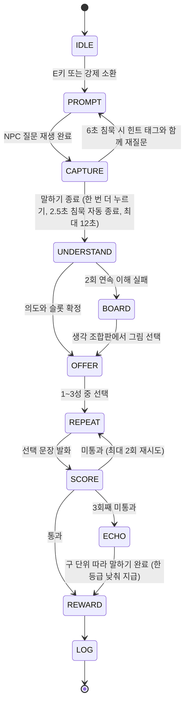
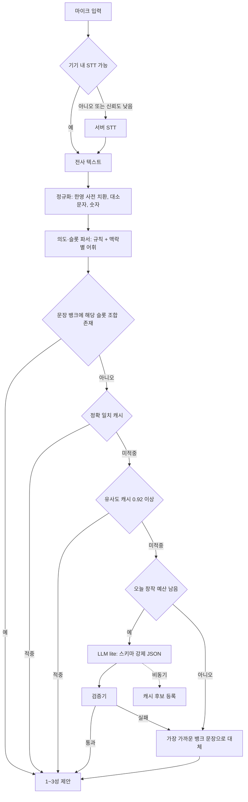

# 04. 회화 엔진

모든 NPC가 같은 엔진을 씁니다. NPC마다 다른 것은 `맥락(ctx)`, `요구 의도`, `보상 파라미터`뿐입니다. 4.1~4.8은 v2에서 가져왔고 4.9 이후는 이번 판에서 추가했습니다.

### 4.1 상태 머신



- **실패해도 빈손으로 나가지 않습니다.** 최악의 경우에도 `ECHO`를 거쳐 1성 보상을 받습니다.
- **생각 조합판(BOARD)**: 부위·효과·색·크기 그림을 눌러 의도를 만드는 판입니다. 단어를 몰라서 막힌 아이를 위한 안전망이면서, 누른 그림이 곧 슬롯이 되므로 이해 단계의 비용이 0입니다.
- **ECHO 진입 대사**: 3회째 미통과로 `ECHO`에 들어갈 때 NPC는 아이가 아니라 환경을 탓합니다. `It's a bit noisy here! Let's take it step by step.`(대사 ID `npc.echo.noisy`, 한글 "여기가 좀 시끄럽네! 조금씩 끊어서 들어볼게.")를 언어 팩에서 읽어 재생합니다. 강등당했다는 느낌을 막기 위한 연출입니다.
- **키보드 입력**: 마이크를 쓸 수 없는 환경을 위한 대안입니다. 입력은 2성까지만 인정하고 `REPEAT`는 음성이 가능할 때 다시 요구합니다.

### 4.2 NPC 맥락별 파라미터

| 맥락 | 트리거 | 요구 의도 | 1성 | 2성 | 3성 | 주 문법·기능 |
|---|---|---|---|---|---|---|
| 카페 | 카운터 접근 | 주문 | 정가 | 20% 할인 | 50% 할인 + 버프 3분 | 요청, 수량, 온도·맛 |
| 부티크 | 카운터 접근 | 의상 주문 | 정가 | 20% | 50% + 희귀 색상 | 묘사, 선호, 사이즈 |
| 제작소 | 카운터 접근 | 장비 주문 | 정가 | 20% | 50% + 성능 태그 1개 | 목적절, 비교급 |
| 환전소 | 광물 소지 | 판매 흥정 | 시세 | +10% | +25% | 숫자, 제안, 양보 |
| 면접 | 정장 착용 | 3턴 응답 | 인턴 채용 | 채용 + 계약금 | 한 단계 위 직급 | 자기소개, 이유 |
| 상사 | 지각·보고 | 변명·보고 | 일급 50% | 일급 100% | 100% + 승진 점수 | 과거 시제, 사과 |
| 고객 | 근무 중 | 클레임 처리 | 처리 1건 | 팁 | 팁 + 단골 | 공감, 대안 제시 |
| 복권방 | 100코인 | 가정법 공약 | 일반 복권 | 상위 확률 2배 | 상위 확률 3배 | 가정법 |
| 법정 | 강제 소환 | 변론 | 벌금 50% | 사회봉사 | 무죄 | 사과, 의도 부정, 약속 |
| 수리소 | 복습일 도래 | 문장 회상 | 복구 | 복구 + 환급 | 복구 + 간격 상승 | 회상 |

### 4.3 레벨 사다리

별은 절대 난이도가 아니라 **현재 레벨에서의 3단계**입니다.

| 레벨 | 대략 | 1성 | 2성 | 3성 |
|---|---|---|---|---|
| L1 | 입문 | `Water, please.` | `Cold water, please.` | `Can I have cold water, please?` |
| L2 | A1 | `I want a red jetpack.` | `Can I get a fast red jetpack?` | `Can I get a red jetpack? I want to fly high.` |
| L3 | A2 | `I'd like a red jetpack, please.` | `Could you build a fast red jetpack with a big fuel tank?` | `I'm looking for a fuel-efficient red jetpack so that I can fly to the space station.` |
| L4 | B1 | 조건·비교 한 가지 | 두 가지 결합 | 조건 + 이유 + 정중한 완충 표현 |
| L5 | B1+ | 업무 표준 문장 | 근거 제시 | 협상·양보 구조 |
| L6 | B2 | 격식 문장 | 반론 예상 | 추상 논증 |

- **별의 정의**: 1성은 교정(의미 유지, 문법 정리), 2성은 수식 확장(형용사·수량·부가 정보), 3성은 절 확장(이유·목적·조건) 또는 상위 어휘입니다.
- **자동 레벨 조정**: 최근 20회 중 3성 1회차 통과가 70% 이상이면 한 단계 상승, 미통과가 40% 이상이면 한 단계 하강합니다. 교사와 학부모는 수동으로 고정할 수 있습니다.
- **첫 배치**: 첫 3회 발화의 길이와 구조로 L1~L3 중 하나에 임시 배치합니다. 성인 구독자는 L3에서 시작합니다.

### 4.4 발화 처리 경로



| 단계 | 처리 위치 | 비용 | 지연 목표 |
|---|---|---|---|
| 기기 내 STT | 클라이언트 (WebGPU Whisper 소형). 기기 등급 높음·보통만, iOS는 높음만 | 0 | 1초 이내 |
| 서버 STT | Workers AI Whisper. 등급 낮음은 모델 로딩 없이 곧바로 이 경로(Opus 16kbps 업로드) | 무료 뉴런 한도 내 | 1.5초 이내 |
| 정규화·파서 | 클라이언트 + 엣지 재검증 | 0 | 50ms |
| 문장 뱅크·정확 일치 | 클라이언트 번들 + D1 | 0 | 50ms |
| 유사도 캐시 | 확장 단계(초기에는 생략) | 임베딩 1회 | 150ms |
| LLM | Workers AI 소형 모델 | 무료 뉴런 한도 내 | 1.5초 이내, 초과 시 뱅크 대체 |

- **STT 3단 구성의 이유**: 브라우저 내장 음성 인식은 언어를 하나만 지정할 수 있고, 일부 브라우저는 지원하지 않으며, 음성이 브라우저 제조사 서버로 전송될 수 있습니다. 미성년자 음성 경로에는 쓰지 않고 성인 대상 체험 씬에만 씁니다.
- **한영 혼용**: 다국어 Whisper 계열은 혼용 발화를 어느 정도 전사합니다. 그 뒤 한국어 토큰을 5천 단어 규모의 내장 사전으로 치환합니다(`빨간색 → red`). 사전에 없으면 해당 단어만 생각 조합판으로 보냅니다.
- **캐시 키**: `(npc_ctx, 의도, 정규화된 슬롯, 레벨)`. 원문 문장이 아니라 **의미 구조**로 키를 잡아야 적중률이 올라갑니다.
- **적중률 계획치**: 출시 시 뱅크 + 캐시로 60%, 6개월 뒤 85%를 가정합니다. 한도 계산은 60% 기준으로 합니다.

### 4.5 계약(JSON)

**이해 요청과 응답**

```json
POST /v1/converse/understand
{
  "dialog_id": "dlg_01J...",
  "npc_ctx": "makers_lab",
  "level": "L3",
  "transcript": "I want 빨간색 jetpack",
  "stt": { "source": "device", "confidence": 0.81 }
}
```

```json
{
  "normalized": "I want a red jetpack!",
  "intent": "order_item",
  "slots": { "item": "jetpack", "color": "red", "modifiers": [], "reason": null },
  "offers": [
    { "stars": 1, "text": "I'd like a red jetpack, please.", "price": 2000, "bonus": null },
    { "stars": 2, "text": "Could you build a fast red jetpack with a big fuel tank?", "price": 1600, "bonus": null },
    { "stars": 3, "text": "I'm looking for a fuel-efficient red jetpack so that I can fly to the space station.", "price": 1000, "bonus": "fuel_x2" }
  ],
  "hint_tags": ["fuel-efficient", "so that", "space station"],
  "item_spec_preview": {
    "kind": "item", "v": 2,
    "name": "Red Jetpack",
    "socket": "Back_Socket",
    "parts": [
      { "id": "barrel_tube", "pos": [-0.2, 0, 0], "color": "#C0392B" },
      { "id": "barrel_tube", "pos": [0.2, 0, 0], "color": "#C0392B" },
      { "id": "nozzle_flare", "pos": [0, -0.5, 0], "color": "#F5B041", "glow": 0.2 }
    ],
    "tags": ["flight_jetpack"],
    "tier": 2,
    "power": { "limit": 10, "used": 5 }
  },
  "source": "bank"
}
```

**채점 요청과 응답**

```json
POST /v1/converse/score
{ "dialog_id": "dlg_01J...", "chosen_stars": 3, "hint_level": "full", "transcript": "I'm looking for a fuel efficient red jetpack so I can fly to the space station", "audio_key": "u/abc/2026/11/15/dlg_01J.opus" }
```

```json
{
  "pass": true,
  "score": 0.88,
  "missed": ["that"],
  "granted": { "item_id": "itm_...", "slot_or_socket": "Back_Socket", "coins_delta": -1000 },
  "memory_card": { "id": "mc_...", "next_review_at": "2026-11-15T10:42:00Z" }
}
```

### 4.6 채점 규칙

1. 목표 문장과 전사문을 소문자·구두점 제거·축약형 전개 후 토큰 정렬합니다.
2. 토큰을 셋으로 나눕니다. ① **핵심 문형 토큰**: 문장의 `hint_tags` 중 기능어·접속 표현을 포함한 구(`so that`, `could you`, `because`, `if you offer`)와 문장 안의 접속 표현(`CONNECTORS`)·`could`/`would`. 내용어만 든 태그(`red jetpack`)는 핵심이 아닙니다. ② **내용어**(명사·동사·형용사·부사). ③ **그 밖의 기능어**(관사, 단순 전치사 등). 계산은 `점수 = 0.45 × 핵심 문형 일치율 + 0.45 × 내용어 일치율 + 0.10 × 기능어 일치율`입니다(이전: `0.8 × 내용어 + 0.2 × 기능어`, 접속사·조동사를 빼고 명사만 나열해도 0.80으로 3성을 통과하던 구멍). 비어 있는 범주의 가중치는 나머지에 비례 배분합니다.
   - **핵심 문형 토큰이 하나도 없는 문장**(`hint_tags`가 없고 접속 표현도 없음)은 이전 가중치 0.8/0.2로 되돌립니다.
   - **3성 상한**: 3성 목표에서 핵심 문형 토큰을 하나도 말하지 않으면 최대 2성까지만 인정합니다(`starCap`). 현재 가중치에서는 핵심을 빼면 점수가 0.55 이하라 이미 미통과이므로 이 상한은 통과 기준을 낮추는 설정이 생겨도 구멍이 되지 않게 하는 이중 안전장치입니다.
   - 예: 목표 `Could you build a fast red jetpack so that I can fly?`, 발화 `build fast red jetpack fly` → 핵심 0%, 내용어 100%, 점수 0.45로 미통과.
3. 통과 기준은 레벨과 힌트 단계에 따라 0.60 ~ 0.75입니다. L1~L2는 0.60에서 시작합니다. 어린이 발화는 STT 오류가 많으므로 기준이 낮아야 하고, 엄격함은 레벨이 올라가며 더합니다.
4. **단어 일치는 관대하게 봅니다**(`wordsMatch`, 상수 `LENIENT_MATCH`, 2026-11-16 운영 Whisper 37개 발화 실측). 아이 발음과 인식기가 흔히 바꾸는 소리를 같은 단어로 셉니다.
   - 말로 쓰는 축약형을 펼칩니다: `wanna`→`want to`, `gonna`, `gotta`, `gimme`, `lemme`, `cuz`/`'cause`→`because`, `plz`→`please`. 숫자와 숫자 단어(`2`=`two`)도 같습니다.
   - 복수·3인칭 -s 를 떼고 봅니다(`smoothies`=`smoothie`).
   - 소리 키(묵음 끝 e, 끝 y/ie/ee 는 i, f/p·v/b·r/l·z/j/s·th→t·c/k)로 바꿔 같거나, 4자 이상에서 한 글자 차이이고 첫소리가 같으면(k/g·t/d·p/b 짝 허용) 일치입니다: `code`·`colt`·`gold`=`cold`, `warter`·`wata`=`water`, `tursty`=`thirsty`, `pleaz`=`please`.
   - 짧은 기능어(5자 미만: `a`, `I`, `can`, `the`…)는 정확히 같아야 합니다. `water`/`later`처럼 첫소리가 다른 단어, `banana`/`juice` 같은 다른 단어는 일치가 아닙니다. 정렬은 정확 일치를 먼저 찾고, 다른 목표 단어와 정확히 같은 발화 단어는 관대 일치에 쓰지 않습니다.
   - 대화창의 "들린 단어" 표시(`heardMask`)도 같은 규칙을 씁니다.
   - **말한 문장으로 채점합니다**(`spokenOffer`, 카카오톡 인앱 실측·외부인 캡처 2026-11-16): 아이는 카드를 누르지 않고 마음에 드는 문장을 읽습니다. 화면의 제안 문장 중 전사가 통과하는 것 가운데 가장 가까운 문장(동점이면 별이 많은 쪽)으로 채점하고 선택도 그 카드로 옮깁니다. ★ 카드가 골라진 채 ★★★ 문장을 말하면 ★★★로 채점됩니다. 통과하는 문장이 없으면 고른 카드 기준(놓친 단어 강조). 서버가 그 문장으로 다시 채점하므로 말한 것보다 더 받지 않습니다. 단어 카드(`board`)는 고른 카드 그대로입니다.
5. 같은 문장을 2회 연속 미통과하면 놓친 단어만 강조해 다시 보여 줍니다.
6. 발음 평가(음소 단위)는 1차 범위에 넣지 않습니다. 전사 일치만으로도 "알아들을 수 있게 말했는가"의 대리 지표가 됩니다.

### 4.7 LLM 호출 계약과 검증기

- **입력**: 맥락, 레벨, 정규화 문장, 슬롯, 허용 메시·태그 목록. 유저 식별 정보는 보내지 않습니다.
- **출력**: 4.5의 응답 스키마를 강제합니다. 스키마 위반은 1회 재시도 후 뱅크 대체입니다.
- **검증기(전부 자동)**
  1. 스키마와 길이: 레벨별 단어 수 상한(L1 6, L2 10, L3 18, L4 24, L5~L6 30)
  2. 어휘: 레벨별 허용 목록 + 확장 단어 최대 2개
  3. 의미 보존: 유저가 말한 슬롯이 세 문장 모두에 남아 있는가
  4. 안전: 금칙어·부적절 주제 필터, 개인 정보 패턴 차단
  5. 아이템: `parts[].id`가 부품 레지스트리에 있는지, 수치 범위(위치·크기·`glow`), `tags` 허용 목록, 파워 예산(`power.used ≤ power.limit`)
- **캐시 승격**: `후보 → 검증됨(검증기 통과 + 서로 다른 유저 3명이 선택 후 통과) → 전역`. 문법 정밀 검사는 야간 배치에서 한 번 더 돌리고, 탈락하면 캐시에서 내립니다.

### 4.8 음성 출력

- NPC 고정 대사(인사, 질문, 판결 등)는 사전 합성한 파일을 CDN에서 재생합니다.
- 제안 문장 3개는 "듣기" 버튼을 눌렀을 때만 합성하고, 문장 해시로 영구 캐시합니다. 뱅크 문장은 배포 시점에 미리 합성해 둡니다.
- 힌트 단계가 올라가면 듣기 버튼을 숨깁니다.

**신경망 NPC 목소리 (11-16 구현, 스위치 `TTS_NEURAL=on`, 기본 꺼짐)**

- 엔진: Workers AI `@cf/deepgram/aura-1`(NPC·모범 문장), 값싼 예비로 `@cf/myshell-ai/melotts`. 외부 LLM·외부 TTS 없음. 아이 목소리는 올리지 않습니다(출력만 합성).
- 배역 목소리는 배역 팩(`npc-cast.ts`)에 있습니다. 영어 팩: 안내인 루나 `athena`, 카페 주인 해나 `hera`, 상점 주인 토비 `arcas`, 이웃 미아 `stella`(가장 높고 어린 목소리), 아이가 따라 말할 모범 문장 `luna`. 12개 Aura 화자를 같은 문장으로 실측(EBU R128 음량·최대 피크·중앙 F0·Whisper 되받아쓰기 WER)해 골랐습니다.
- 경로: `GET /v1/tts?v=<engine-speaker>&t=<문장>` → R2 `tts/v1/<voice>/<sha256 40자>.mp3` 캐시를 먼저 보고, 없으면 합성해 넣습니다. 같은 문장은 한 번만 만듭니다. 응답은 `cache-control: public, immutable`, `x-lcw-tts: hit|miss`.
- 누가 무엇을: 고정 대사(`fixedTtsLines()` — NPC 인사·심부름 대사·반응·열린 질문·되따라 말하기 안내·뱅크 문장 전부)는 로그인 없이도 받습니다. 그 밖의 문장(수업에서 선생님이 NPC로 하는 말)은 아이 토큰(학생·기기)이나 운영자만 만듭니다. 300자 넘으면 413.
- 한도: 합성은 뉴런 계량기(`QuotaMeter.canUseTts`, `ttsNeurons`)를 지납니다. 혼자 놀기는 2단계부터, 수업은 3단계부터 새 합성을 멈추고(캐시된 줄은 계속 무료), 수업 예비분은 건드리지 않습니다. 비용 ≈ Aura 1.37 뉴런/글자 — NPC 고정 대사 46줄 ≈ 2,200 뉴런, 뱅크 문장까지 749줄 ≈ 38,800 뉴런.
- 미리 만들기: `POST /v1/admin/tts/prebuild {budget_neurons}`(운영자)가 NPC 대사부터 순서대로 예산만큼 만들고 남은 수를 돌려줍니다. 여러 날에 나눠 부르거나, 뱅크 문장은 첫 🔊 탭 때 만들어지게 둡니다. 시험 듣기: `POST /v1/admin/tts/try {voice, text}`.
- 클라이언트(`dialog/neural-voice.ts`, `dialog/sound.ts`): `/v1/tts/status` 를 한 번 묻고, 켜져 있으면 NPC 대사는 그 NPC 목소리로, 🔊·되따라 말하기 조각은 모범 목소리로 재생합니다. 대화창이 열리면 NPC 대사를 먼저 받고 이어 제안 문장 3개를 미리 받습니다. 1.5초 안에 안 오거나, 꺼져 있거나, 거절·실패하면 기기 목소리(speechSynthesis)로 읽습니다. 재생은 레벨 말 속도(`speechRate`, 음높이 유지), `voice_npc` 버스, 덕킹, 마이크 탭으로 끊기(`lcw:npc-voice-cut`) 모두 기기 목소리와 같습니다. 줄마다 음량을 버스 목표(−16 LUFS)에 맞추되 리미터에 닿지 않게 피크를 묶습니다. `?voice=device` 로 강제로 기기 목소리를 씁니다.
- 실측(로컬 엣지 + 실제 Workers AI, 11-16): 새 문장 0.4~1.3초(서버), 캐시된 문장 대화창 열림 뒤 86 ms에 재생 시작, 미리 받은 🔊 탭 11 ms. 페이지 출력 녹음에서 NPC(hera) −20.7 LUFS, 모범(luna) −20.2 LUFS로 두 목소리 차이 0.5 dB.


### 4.9 발화 모드 분류

모든 발화에 모드를 붙여 저장합니다. 학부모 지표의 핵심은 낭독이 아니라 자유 발화이므로 이 구분이 측정의 기초입니다.

| 모드 | 정의 | 예 |
|---|---|---|
| `free` | 화면에 문장이 없는 상태에서 스스로 만든 발화 | NPC 질문에 대한 첫 발화, 열린 질문 답, 교사와의 대화, 쇼앤텔 |
| `guided` | 힌트 태그나 조합판을 보고 만든 발화 | 조합판으로 의도를 만든 뒤 말하기 |
| `read` | 화면의 전체 문장을 보고 말한 발화 | 1~3성 제안 따라 말하기 |
| `recall` | 힌트가 줄어든 상태의 회상 | 복습 3일차 이후, 마스터 도전 |

### 4.10 열린 질문 (한 마디 더)

보상을 준 뒤 NPC가 다섯 번에 한 번꼴로 열린 질문을 덧붙입니다(`Why do you need it?`, `What will you do next?`). 답하지 않아도 불이익은 없습니다.

- 통과 조건: 목표 언어 4단어 이상(L1~L2는 2단어), 맥락 어휘 1개 이상 포함. 문법은 보지 않습니다.
- 보상: 팁 코인(단어 수 × 2, 상한 40)과 단골 점수.
- NPC의 반응은 범용 반응 뱅크에서 고릅니다. 예산이 남으면 LLM이 맥락에 맞는 한 문장을 만듭니다.
- 이 발화는 `free` 모드로 기록됩니다. 혼자 플레이할 때도 대본 없는 말하기가 쌓이게 하는 장치입니다.
- 교사가 NPC에 빙의해 있으면 열린 질문은 교사가 직접 합니다(`06`).

### 4.11 음성 스킬 인식

전투 중 음성 스킬은 회화 엔진의 축약 경로를 씁니다. 인식 결과를 `동사 12종 × 대상 목록 × 형용사 목록`과 대조해 등급(단어·구·문장)만 판정합니다. 서버 호출이 없고 지연 목표는 400ms입니다. 이 경로만 발화 종료 침묵을 500ms로 짧게 씁니다(일반 대화·수업은 1,500ms, `12`의 9장). 문장 등급은 `so that`, `because`, `before`, `when` 같은 접속 표현 뒤에 3단어 이상이 이어질 때 인정합니다.

### 4.12 말풍선 경로

멀티플레이 말풍선(`03`의 D11)은 `인식 → 목표 언어 판별 → 금칙어·개인정보 필터 → 전송` 순서입니다. 판별은 언어 팩의 어휘 목록 대조로 하고 LLM을 쓰지 않습니다. 금칙어·개인정보는 전송하지 않고 본인에게만 사유를 보여 줍니다(하드 차단). 목표 언어 비율이 70% 미만이어도 바로 막지 않고 4.4의 한영 사전 치환기를 먼저 돌려 영어로 바뀐 문장을 보냅니다(`이거 red brick 어디 놔?` → `This red brick where put?`). 치환이 일어나면 본인 화면에 "이렇게 바뀌어 전달됐어요!"(언어 팩 UI 문자열 `player.bubbleSubstituted`)를 띄웁니다. 치환 뒤에도 70% 미만이면 그때만 막습니다. `지우야`처럼 친구를 부르는 한국어 호칭(이름+야/아)은 비율 계산에서 뺍니다(이전: 70% 미만이면 무조건 차단).

### 4.13 언어 팩

목표 언어와 모국어의 조합마다 팩 하나입니다. 출시 팩은 `en` 목표, `ko` 모국어입니다.

```text
/content/lang/en-ko/
  manifest.json        목표 언어, 모국어, 인식 모델 설정, 합성 음성 목록
  levels.json          L1~L6 정의: 단어 수 상한, 허용 문형, 접속 표현 목록
  lexicon.l1.json      모국어 → 목표 언어 사전 (혼용 발화 치환용, 약 5천 항목)
  vocab.L1..L6.json    레벨별 허용 어휘
  bank/*.jsonl         맥락별 문장 뱅크
  skills.json          음성 스킬 동사·대상·형용사
  reactions.json       NPC 범용 반응
  filters.json         금칙어, 개인정보 패턴
  ui.ko.json           모국어 UI 문자열
```

새 언어를 여는 절차: 팩 초안 생성(개발자가 대화형 LLM으로) → 검증기 통과 → **원어민 검수** → 소수 사용자 공개 → 전체 공개. 원어민 검수 없이 연 언어는 틀린 문장을 가르칠 위험이 있으므로 이 단계는 건너뛰지 않습니다.
