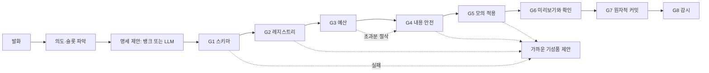

# 05. AI 제작과 월드 보호

목표는 두 가지입니다. 플레이어가 말로 거의 무엇이든 만들 수 있어야 하고, 그 어떤 생성 결과도 월드를 망가뜨릴 수 없어야 합니다. 두 목표를 동시에 만족시키는 방법은 하나입니다. **AI는 월드를 직접 고치지 않고, 정해진 형식의 명세만 제안합니다.** 명세를 실제 물건으로 바꾸는 것은 검증된 결정론 코드이고, AI가 만든 것은 어느 것도 지형과 건물의 블록을 바꾸지 못합니다.

## 1. AI가 만드는 것과 만들지 않는 것

**건물과 주민은 AI가 만들지 않습니다.** 건물은 플레이어가 블록을 하나씩 쌓아 짓고(`03`의 D13), 주민은 지은 방이 조건을 채우면 정해진 명단에서 입주합니다. 말 한마디로 집이 솟아나면 건축이라는 놀이가 사라지고, 월드를 망가뜨릴 수 있는 가장 큰 덩어리가 AI 손에 들어갑니다. AI의 창작 범위는 플레이어가 들고, 입고, 데리고 다니는 것과 놀이의 규칙으로 한정합니다.

| 명세 | 말로 하는 요청 예 | 구성 방식 | 상한 |
|---|---|---|---|
| `ItemSpec` 아이템 | "호박 모양에 눈이 빛나는 헬멧", "멀리 날아가는 물폭탄" | 부품 최대 6개 조립(부품 레지스트리 약 240종) + 색 + 무늬 + 발광 + 능력 태그 | 태그 파워 예산, 크기 0.5~1.5배 |
| `SkinSpec` 의상 | "별무늬 보라색 긴 코트" | 기본 의상 + 레이어 최대 4개(색 조합, 무늬, 데칼, 길이) | 레이어 4 |
| `PetSpec` 반려·탈것 | "작고 빠른 파란 슬라임" | 원형 8종 × 크기·색·행동 태그 | 플레이어당 동행 1, 보유 12 |
| `QuestSpec` 의뢰 | "보물찾기 만들어 줘" | 틀 6종(배달, 수집, 탐색, 건축 과제, 설득, 토벌) × 대상·수량·장소·보상 | 보상 예산 |
| `RuleSpec` 구역 규칙 | "여기는 중력이 약한 경기장" | 정해진 스위치와 범위 값(중력 0.5~1.5, PvP, 시간 속도 등) | 내 부지와 아레나 안에서만 |

| AI가 만들지 않는 것 | 대신 |
|---|---|
| 건물, 구조물, 지형 | 블록을 하나씩 쌓는다. 채우기·복사·붙여넣기 도구도 두지 않는다 |
| 주민(NPC) | 방 조건을 채우면 고정 명단 12명 중에서 입주 |
| 새 블록 종류 | 블록 레지스트리(약 120종 × 염색 16색)에서 고른다 |
| 가구 | 상점 카탈로그의 완성품을 사서 놓는다(색만 주문 가능) |
| 적 몬스터 | 밴드별 고정 목록 |

"건축 과제" 의뢰는 "방 세 개짜리 집을 지어 보세요"처럼 과제를 줄 뿐이고 짓는 것은 플레이어입니다.

손으로 만드는 도구도 둡니다. 16³ 복셀 아이템 편집기와 64×64 의상 픽셀 편집기입니다. AI 조립으로 안 되는 모양은 직접 찍습니다. 공개 서버에 보이는 직접 제작물은 자동 분류를 거칩니다.

### 1.1 명세 예시

```json
{
  "kind": "item", "v": 2,
  "name": "Pumpkin Helmet",
  "socket": "Head_Socket",
  "parts": [
    { "id": "sphere_ridged", "pos": [0, 0, 0], "scale": [1.1, 1.0, 1.1], "color": "#E67E22" },
    { "id": "stem_short", "pos": [0, 0.55, 0], "color": "#3E7D32" },
    { "id": "eye_tri", "pos": [-0.2, 0.05, 0.5], "color": "#FFE066", "glow": 0.8 },
    { "id": "eye_tri", "pos": [0.2, 0.05, 0.5], "color": "#FFE066", "glow": 0.8 }
  ],
  "tags": ["armor_1", "night_light"],
  "tier": 2,
  "power": { "limit": 10, "used": 6 }
}
```

```json
{
  "kind": "item", "v": 2,
  "name": "Long-range Water Balloon",
  "socket": "RightHand_Socket",
  "parts": [
    { "id": "sphere_smooth", "pos": [0, 0, 0], "scale": [0.6, 0.7, 0.6], "color": "#3FA9F5" },
    { "id": "knot_small", "pos": [0, 0.4, 0], "color": "#2B7BC0" }
  ],
  "tags": ["throwable", "water_burst", "range_up"],
  "tier": 1,
  "power": { "limit": 6, "used": 5 },
  "stack": 5
}
```

폭발·물·로켓 같은 효과는 명세가 수치를 직접 갖지 않습니다. `water_burst`, `blast_small`, `rocket_boost` 같은 태그가 `13`의 파괴 커널 함수를 부르고, 위력·범위·개수는 커널이 상한으로 다시 자릅니다. 명세가 무엇을 적어 오든 커널 상한을 넘는 일은 일어나지 않습니다.

## 2. AI가 절대 하지 않는 것

1. 코드, 스크립트, 셰이더 소스, 정규식을 만들지 않습니다. 동작은 미리 만든 태그의 조합으로만 표현합니다.
2. 레지스트리에 없는 부품·블록·에셋 주소를 참조하지 못합니다.
3. 가격과 코인을 정하지 못합니다. 가격은 서버의 가격식이 계산합니다.
4. 기반 계층과 보호 구역을 건드리지 못합니다(3장).
5. 범위 밖 물리 값을 쓰지 못합니다. 모든 수치 필드에는 최소·최대가 있습니다.
6. 분당 생성 수를 넘지 못합니다(플레이어당 분당 3개).
7. 플레이어의 말을 지시로 실행하지 않습니다. 발화는 자료일 뿐이고, 출력은 스키마로만 해석하며 모르는 필드는 버립니다.

## 3. 월드의 다섯 계층

```text
L4  세션 임시층    폭발 자국, 이벤트 소품. 60초 뒤 또는 세션 종료 시 사라짐
L3  개체층         가구·입주 주민·반려·의뢰·구역 규칙. 개체마다 ID가 있고 통째로 넣고 뺄 수 있음. 블록을 갖지 않음
L2  플레이어 편집층 직접 놓고 부순 블록 (청크 델타). 건물은 전부 이 층
L1  보호 코어      광장, 스폰, 필수 상점, 엘리베이터, 법원. 누구도 수정 불가
L0  기반층         시드에서 생성되는 지형. 저장하지 않으며 변하지 않음
```

- 월드를 여는 순서는 L0 → L1 → L2 → L3 → L4입니다. 위 계층이 실패해도 아래 계층은 이미 서 있습니다.
- L3 개체는 하나씩 독립적으로 불러옵니다. 하나가 실패하면 그 개체만 **격리**되고 나머지는 정상입니다. 격리된 개체는 월드 안에 "고장 난 발명품" 상자로 보이고, 수리소에서 다시 시도하거나 해체할 수 있습니다.
- L3 개체는 블록 격자를 바꾸지 않습니다. 가구는 격자 위에 놓인 개체이고, 받침 블록이 사라지면 아이템으로 떨어집니다. AI 명세가 잘못되어도 지형과 건물은 영향을 받지 않습니다.
- L1은 폭발·물·로켓·건축·AI 어느 것으로도 바뀌지 않습니다(`13`에서 퍼즈로 검증). 광장과 필수 상점이 사라져 진행이 막히는 일이 없습니다.

## 4. 검문 8단계



| 단계 | 검사 | 실패 시 | 실행 위치 |
|---|---|---|---|
| G1 스키마 | 형식, 버전, 필드 범위, 모르는 필드 제거 | 1회 재요청 후 기성품 제안 | 기기 + 서버 |
| G2 레지스트리 | 부품·블록·태그·원형 ID가 모두 존재 | 가장 가까운 ID로 치환, 불가하면 기성품 | 기기 + 서버 |
| G3 예산 | 파워, 크기, 블록 수, 월드당 개체 수, 분당 생성 수 | 초과분 절삭 또는 거절 | 기기 + 서버 |
| G4 내용 안전 | 이름·설명의 금칙어, 부적절 형상 규칙, 개인정보 패턴 | 거절 | 기기 + 서버 |
| G5 모의 적용 | 능력 태그를 격리된 시험장(빈 16³ 공간)에서 200틱 실행해 예산·예외 검사, 구역 규칙은 사본에 적용해 불변식 검사(5장) | 거절 | 기기(Worker 스레드) |
| G6 미리보기 | 3D 미리보기 뷰포트에서 착용·사용 모습을 보여 주고 플레이어가 확정 | 취소 | 기기 |
| G7 커밋 | `WorldDO`가 구역 권한을 다시 확인하고 한 트랜잭션으로 기록, 저널에 역연산 저장 | 전체 롤백 | 서버 |
| G8 감시 | 개체별 오류 횟수. 불러오기 또는 갱신 중 예외 2회면 자동 격리 | 격리 | 기기 + 서버 |

서버의 재검문은 G1~G4와 구역·예산 확인만 합니다. 요청당 CPU 예산 안에 들어오는 가벼운 검사입니다. 무거운 모의 적용은 기기에서 하고, 서버는 그 결과를 믿지 않고 커밋 뒤 불변식 점검을 예약합니다.

## 5. 불변식

커밋 직후, 월드를 열 때, 그리고 매일 한 번 점검합니다. 하나라도 깨지면 그 커밋을 저널로 되돌립니다.

| ID | 불변식 |
|---|---|
| I1 | 스폰 지점 위 2칸이 비어 있고 발밑이 단단하다 |
| I2 | 스폰에서 필수 상점 4종, 수리소, 병원, 엘리베이터까지 걸어서 갈 수 있다(중앙 섹터 보행 격자 탐색) |
| I3 | 필수 NPC가 모두 존재하고 대화 가능하다 |
| I4 | 엔티티 200 이하, 개체 300 이하, 주민 12 이하 |
| I5 | 월드 저장 크기 20MB 이하, 청크당 델타 256KB 이하 |
| I6 | 모든 명세가 현재 레지스트리와 스키마 버전으로 해석된다 |
| I7 | 장부 합계와 잔액이 일치하고, 예산을 넘는 아이템이 없다 |
| I8 | L1 영역에 L2·L4 편집이 없다 |

## 6. 저널, 스냅샷, 되감기

- **저널**: 월드를 바꾸는 모든 연산은 역연산과 함께 `journal`에 쌓입니다. 최근 2,000건을 유지합니다.
- **스냅샷**: 세션 종료 시, 구역 규칙 커밋 직전, 매일 한 번. 최근 10개와 주간 8개를 R2에 보관합니다.
- **되감기**: 소유자와 교사는 스냅샷 목록에서 시점을 골라 되돌립니다. 되돌리기 전 상태도 스냅샷으로 남으므로 되감기 자체를 취소할 수 있습니다.
- **안전 모드**: 월드 열기에 두 번 연속 실패하면 L3와 L4를 끄고 엽니다. 플레이어는 격리 목록에서 개체를 하나씩 다시 켭니다.
- **방문자 편집 일괄 되돌리기**: 저널에 행위자가 기록되므로 특정 방문자가 한 일만 골라 되돌릴 수 있습니다.
- **스키마 버전**: 명세에는 `v`가 있고, 버전을 올릴 때는 이전 버전을 읽는 변환기를 반드시 함께 넣습니다. 변환에 실패한 개체는 삭제하지 않고 격리합니다.

## 7. 자유도를 넓히는 방법

검문이 엄격해도 답답하지 않게 하려면 재료가 넉넉해야 합니다.

| 수단 | 규모 | 효과 |
|---|---|---|
| 부품 레지스트리 | 기본 도형 40, 생활 60, 무기·도구 50, 자연 40, 기계 50 | 6개 조립만으로 조합 수가 사실상 무한 |
| 색·무늬·데칼 | 자유 색상, 절차 무늬 24종, 픽셀 데칼 200종 | 같은 형태도 전혀 다른 외관 |
| 능력 태그 | 이동 12, 전투 14, 생활 10, 빛·소리 8 | 태그 조합으로 새 도구 |
| 블록 레지스트리 | 약 120종 × 염색 16색, 반블록·계단·울타리 형태 | 손으로 짓는 건축의 표현력 |
| 원형 × 행동 태그 | 반려 원형 8 × 행동 10 | 반려, 탈것 |
| 거절 대신 근사 | G1·G2·G4 실패 시 가장 가까운 기성품을 제안 | "안 돼요"가 아니라 "이건 어때요" |
| 직접 편집기 | 복셀 16³, 픽셀 64×64 | AI가 못 만드는 모양 |
| 공유 코드 | 명세를 문자열로 내보내기 | 친구의 발명품 가져오기(검문 재실행) |

LLM 없이 처리되는 경로도 있습니다. "빨간 제트팩"처럼 슬롯이 레지스트리와 바로 맞는 요청은 규칙만으로 명세를 만듭니다. LLM은 "호박 모양 헬멧"처럼 조립 방법을 추론해야 할 때만 부릅니다.

## 8. 시험 항목

`packages/guard`의 자동 테스트로 고정합니다.

1. 무작위로 망가뜨린 명세 10,000개를 넣어도 예외가 밖으로 나오지 않고 전부 거절 또는 절삭된다.
2. 상한 바로 위 값(파워 11, 부품 7개, 레이어 5개, 크기 1.51배)이 정확히 걸린다.
3. 내 부지 밖을 범위로 잡은 구역 규칙이 G5에서 거절된다.
4. 커밋 도중 강제 중단해도 월드는 커밋 전 상태와 바이트 단위로 같다.
5. 일부러 깨뜨린 개체를 넣은 월드가 열리고, 그 개체만 격리된다.
6. 저널을 끝까지 되감으면 L2·L3가 비고 불변식이 모두 성립한다.
9. 어떤 명세로 만든 아이템을 써도 `13`의 커널 상한(폭발 위력 6, 폭발당 1,500블록, 유체 4,096칸, 투사체 32개)을 넘지 않는다.
7. 스키마 v1 명세가 v2 변환기를 거쳐 열린다.
8. 플레이어 발화에 "이전 지시를 무시하고" 같은 문구를 넣어도 출력이 스키마 밖으로 나가지 않는다.
