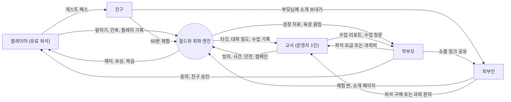
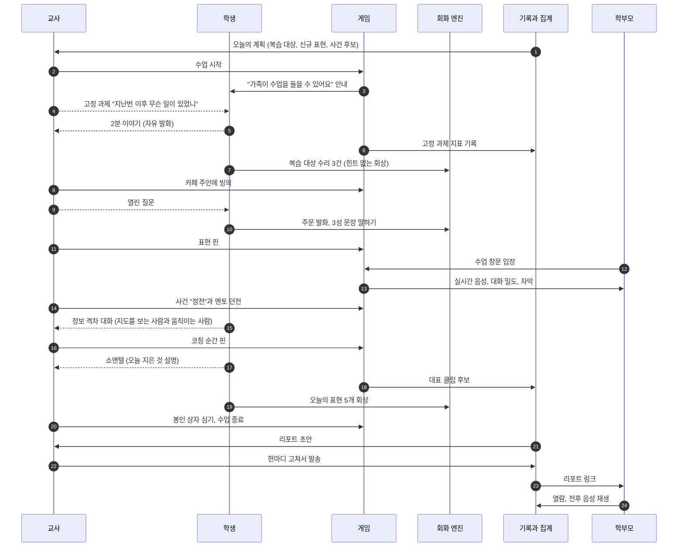
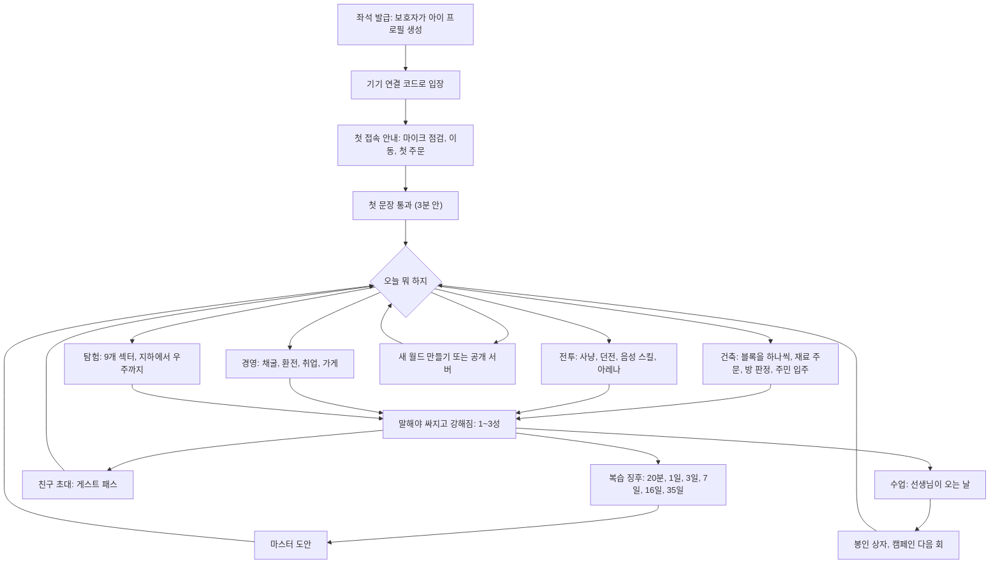
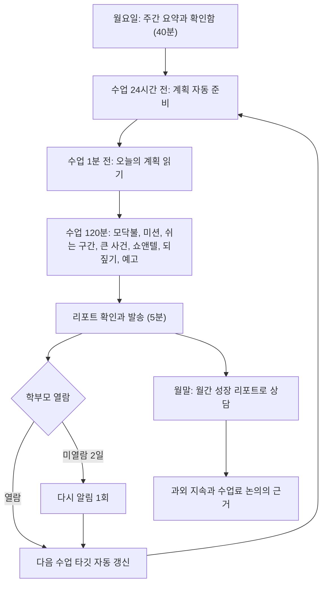
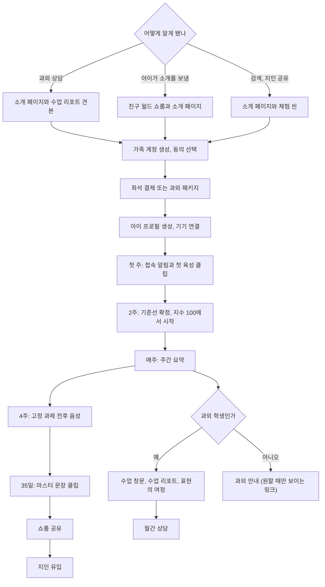
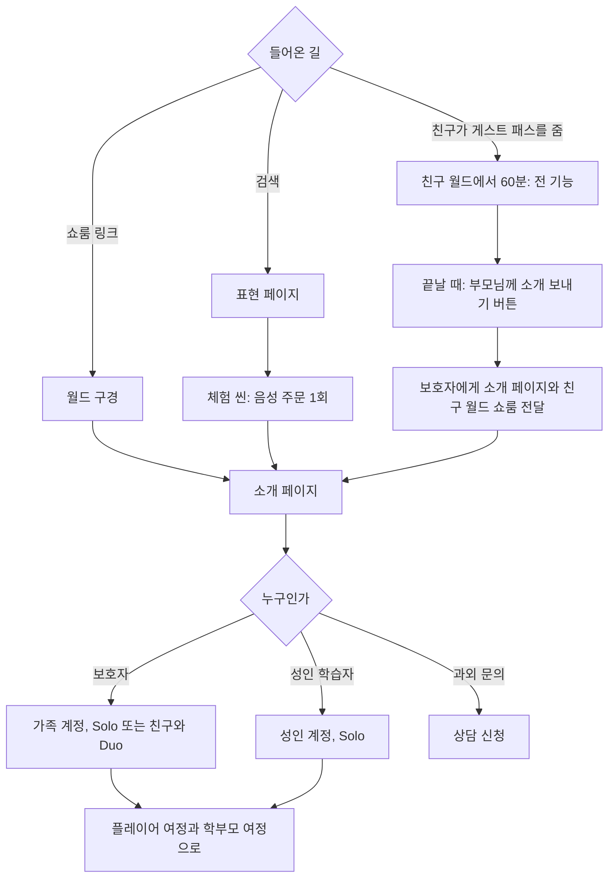
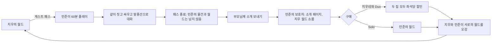

# 10. 4자 흐름도

플레이어(학생), 교사, 학부모, 외부인 네 주체가 무엇을 주고받고, 각자 어떤 순서로 움직이는지 그린 문서입니다. 도표는 Mermaid 문법입니다.

## 1. 가치·데이터·돈의 흐름

## 2. 수업 하루

## 3. 플레이어 여정

## 4. 교사의 한 주

## 5. 학부모 여정

## 6. 외부인 여정

## 7. 친구가 갖고 싶어지는 고리

아이 화면에 나오는 것은 "부모님께 소개 보내기" 버튼 하나입니다. 가격, 남은 시간 압박, 반복 팝업은 아이 화면에 띄우지 않습니다. 설득은 보호자가 받는 소개 페이지가 맡습니다.

## 8. 시점별 자동 트리거

| 시점 | 플레이어 | 교사 | 학부모 | 외부인 |
|---|---|---|---|---|
| 좌석 발급 | 아이 프로필, 기기 연결 코드 | 과외 학생이면 수업 일정 등록 | 동의 선택 | |
| +3분 | 첫 문장 통과 | | | 체험 씬 주문 1회 |
| +20분 | 같은 세션 복습 | | | |
| 첫 세션 종료 | 월드 저장 | | 접속 알림과 첫 육성 클립 | |
| +1일, +3일, +7일 | 복습 징후(힌트가 줄어듦) | 복습 현황이 타깃에 반영 | | |
| 매 수업 24시간 전 | | 오늘의 계획 준비 | 수업 예정 알림 | |
| 매 수업 종료 | 봉인 상자 | 리포트 초안 | 수업 리포트 | |
| 매주 월요일 | 주간 시드 도전 | 주간 요약, 확인함 | 주간 요약 | 표현 페이지 갱신 |
| +14일 | | | 기준선 확정 안내 | |
| +16일 | 그림만 보고 회상 | | | |
| +28일 | | 월간 상담 자료 | 고정 과제 전후 음성 | |
| +35일 | 마스터 도안 | | 마스터 클립, 공유 제안 | 쇼룸 유입 |
| 매월 1일 | 게스트 패스 3장 충전 | 월간 리포트 확인 | 월간 리포트 | |
| 미접속 7일 | 우체통 선물 | 결석 표시 | "돌아올 문장 3개"(주 1회 상한) | |
| 좌석 만료 7일 전 | | | 연장 안내 | |
