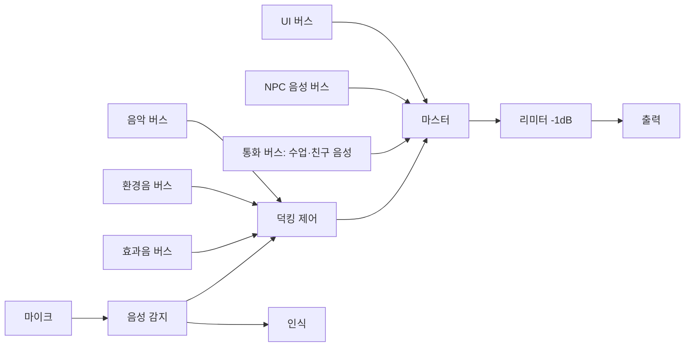

# 12. 소리 설계

이 제품에서 가장 중요한 소리는 사람의 말입니다. 음악과 효과음은 말을 돋보이게 하고, 말하는 순간에는 물러납니다. 이 문서는 그 원칙을 버스 구조, 음량 기준, 소리 목록, 구현 규칙으로 옮긴 것입니다.

## 1. 원칙

1. **말이 주인공.** 누군가 말하거나 마이크가 열리면 음악과 효과음이 자동으로 줄어듭니다.
2. **모든 행동에 50ms 안의 소리.** 블록 하나, 버튼 하나에도 반응이 있어야 손맛이 납니다.
3. **귀가 편해야 한다.** 2시간 수업을 헤드셋으로 듣습니다. 날카로운 고음, 갑작스러운 큰 소리, 끝없이 도는 짧은 반복을 피합니다.
4. **소리에만 의존하지 않는다.** 모든 소리 신호에는 화면 표시가 따라갑니다.
5. **실패의 소리는 없다.** 틀렸을 때 낙담시키는 소리를 쓰지 않습니다. "한 번 더"는 중립적인 나무 두드림 한 번입니다.
6. **출처가 분명한 소리만.** 다른 게임의 소리를 가져오지 않습니다. 직접 만들거나, 합성하거나, 사용 조건이 명확한 것만 씁니다.

## 2. 신호 흐름



| 버스 | 내용 | 기본 음량 | 동시 재생 상한 |
|---|---|---|---|
| 음악 | 섹터별 층 음악 | 60% | 스템 3 |
| 환경음 | 날씨, 장소 | 70% | 4 |
| 효과음 | 블록, 전투, 폭발, 세계 | 85% | 16 |
| UI | 버튼, 알림, 별 | 85% | 4 |
| NPC 음성 | 합성 음성, 감탄사 | 100% | 2 |
| 통화 | 수업·친구의 실제 음성 | 100% | 8 |

- 동시 재생 상한을 넘으면 우선순위(통화 > NPC 음성 > UI > 효과음 > 환경음)가 낮고 오래된 소리부터 끕니다.
- 브라우저는 사용자의 첫 입력 전에는 소리를 내지 못합니다. 첫 화면의 "시작" 버튼에서 오디오를 깨웁니다.
- 탭이 가려지면 음악과 환경음을 멈추고, 통화 버스만 유지합니다.

## 3. 덕킹

| 상황 | 음악 | 환경음 | 효과음 | 복귀 |
|---|---|---|---|---|
| 대화창에서 마이크 열림 | −24dB | −18dB | −12dB | 닫힌 뒤 400ms에 걸쳐 |
| NPC가 말하는 중 | −12dB | −9dB | −6dB | 300ms |
| 수업 중(상시) | −9dB | −6dB | −3dB | 수업 종료 시 |
| 수업 중 누군가 말하는 중(음성 감지) | −24dB | −18dB | −9dB | 600ms |
| 음성 스킬·말풍선 입력 중 | −18dB | −12dB | −6dB | 300ms |
| 수업 창문(보호자) | 게임 소리 없음. 통화 버스만 | | | |

**마이크와 스피커가 섞이지 않게 하는 순서**

1. NPC 음성이 끝난다.
2. 150ms 쉰다.
3. "마이크 열림" 신호음(짧은 상승 2음)이 난다.
4. 신호음이 끝난 뒤 녹음을 시작한다. 신호음이 인식 결과에 섞이지 않게 하기 위함이다.
5. 마이크가 열려 있는 동안 NPC 음성과 UI 소리는 재생하지 않는다.

마이크는 브라우저의 반향 제거, 잡음 억제, 자동 음량 조절을 켠 상태로 엽니다. 스피커로 듣는 환경에서도 동작하게 하되, 첫 접속 안내에서 헤드셋을 권합니다.

## 4. 음량 기준

| 대상 | 기준 |
|---|---|
| 음악 | 통합 −20 LUFS 안팎 |
| NPC 음성 | −16 LUFS 안팎, 문장 간 편차 ±2 |
| 효과음 | 최대 −6 dBFS, 폭발류는 −3 dBFS |
| UI | 최대 −12 dBFS |
| 마스터 | 리미터 천장 −1 dB, 기본 마스터 음량 70% |
| 저음 | 40Hz 아래는 잘라 냄(작은 스피커 보호, 피로 감소) |

"청력 보호" 옵션은 기본으로 켜 둡니다. 브라우저는 실제 귀에 닿는 음압을 알 수 없으므로 이 옵션이 하는 일은 디지털 출력 상한을 낮추고 폭발음의 순간 음량을 6dB 줄이는 것까지입니다. 기기 음량은 보호자가 확인해야 한다는 안내를 첫 접속 때 한 번 보여 줍니다.

## 5. 음악

### 5.1 구조

음악은 섹터마다 3개 층(바탕, 선율, 리듬)으로 만들고 상황에 따라 층을 켜고 끕니다.

| 상태 | 켜지는 층 | 전환 |
|---|---|---|
| 탐험(낮) | 바탕 + 선율 | 마디 경계에서 2초 교차 |
| 탐험(밤) | 바탕(느린 변주) | |
| 상점 안 | 바탕 + 선율(작게, 고음 줄임) | 문을 지날 때 |
| 대화창 | 바탕만 | 덕킹과 함께 |
| 위험·전투 | 바탕 + 리듬 | 적 발견 후 1초 |
| 수업 모닥불 | 전용 곡(기타 한 대) | |
| 승리·획득 | 3~5초 짧은 곡 | 겹쳐 재생 |

- 음악은 쉬어 갑니다. 한 곡(2~3분)이 끝나면 60~120초 동안 환경음만 들립니다. 2시간 내내 음악이 울리면 귀가 지치고 말소리가 묻힙니다.
- 모든 곡은 서로 가까운 조성(C, G, F, A단조, D단조)과 80~110 BPM 안에서 만들어 섹터를 넘을 때 어색하지 않게 합니다.
- 가사가 있는 노래는 쓰지 않습니다. 목표 언어 듣기를 방해합니다.

### 5.2 섹터별 편성

| 섹터 | 악기 | 조성 · 빠르기 | 느낌 |
|---|---|---|---|
| 중앙 광장 | 마림바, 피아노, 손뼉 | C · 96 | 집 |
| 사하라 | 우드, 손북, 플루트 | D단조 · 88 | 느긋한 열기 |
| 런던 | 피아노, 첼로, 빗소리 타악 | F · 84 | 차분한 비 |
| 알프스 | 글로켄슈필, 호른, 현 | G · 80 | 맑고 넓음 |
| 뉴욕 | 전기 피아노, 베이스, 브러시 드럼 | C · 104 | 바쁜 아침 |
| 아마존 | 칼림바, 나무 타악, 새소리 음정 | A단조 · 92 | 깊은 숲 |
| 하와이 | 우쿨렐레, 스틸 기타, 셰이커 | F · 100 | 한가로움 |
| 도쿄 | 신시사이저, 고토 음색, 808 | A단조 · 108 | 네온 밤 |
| 텍사스 | 통기타, 하모니카, 발 구르기 | G · 96 | 넓은 들 |
| 광산 | 낮은 패드, 금속 울림 | D단조 · 박자 없음 | 긴장 없는 어둠 |
| 네더 | 낮은 드론, 느린 북 | D단조 · 80 | 열과 무게 |
| 하늘섬 | 하프, 합창 패드 | C · 84 | 가벼움 |
| 정거장·우주 | 유리 패드, 느린 아르페지오 | A단조 · 박자 없음 | 고요 |

### 5.3 조달

| 방법 | 장점 | 주의 |
|---|---|---|
| 직접 작곡(무료 DAW·트래커) | 통일감, 권리 명확 | 시간 |
| 사용 조건이 공개된 음원 모음(CC0 등) | 빠름 | 조건을 파일별로 기록 |
| 생성형 음악 도구 | 빠름 | 상업 이용·권리 귀속 조건을 도구별로 확인. 조건이 불분명하면 쓰지 않음 |

모든 음원은 `assets/audio/LICENSES.md`에 파일명, 출처, 조건, 확인일을 적습니다. 기록이 없는 파일은 빌드에서 빠지도록 검사 스크립트를 둡니다.

## 6. 효과음

### 6.1 이름 규칙

`<분류>.<대상>.<동작>[.<재질>]` 형태의 ID로 부르고, 파일은 `sfx/<분류>/<이름>_<변주번호>.webm`입니다. 자주 나는 소리는 변주 3~4개를 두고 재생 때마다 음높이를 ±2반음 안에서 무작위로 바꿔 기계적인 반복을 피합니다.

### 6.2 목록

| ID | 언제 | 소리 묘사 | 변주 |
|---|---|---|---|
| `ui.click` / `ui.open` / `ui.close` | 버튼, 패널 | 짧은 나무 클릭 / 종이 펼침 / 종이 접힘 | 2 |
| `ui.tab` / `ui.error` | 탭 전환 / 불가 | 가벼운 틱 / 낮은 둔탁음 1회 | 1 |
| `dlg.mic_on` / `dlg.mic_off` | 마이크 | 사인파 660→880Hz 60ms / 880→660Hz | 1 |
| `dlg.heard` | 인식 완료 | 부드러운 물방울 | 1 |
| `dlg.offer` | 1~3성 제안 등장 | 카드 3장이 차례로 놓이는 소리 | 1 |
| `dlg.pass.1` / `.2` / `.3` | 통과 | C5 한 음 / C5–E5 / C5–E5–G5–C6 상승, 음당 80ms, 맑은 종 | 1 |
| `dlg.again` | 한 번 더 | 나무 두드림 1회(중립) | 1 |
| `dlg.word_hit` | 단어가 칠해질 때 | 아주 짧은 틱, 단어마다 반음씩 상승 | 1 |
| `eco.coin_spend` / `eco.coin_gain` | 코인 | 동전 2닢 / 동전 여러 닢 상승 | 2 |
| `eco.register` | 구매 완료 | 금전 등록기 종 | 1 |
| `item.get` / `item.equip` | 수령 / 착용 | 반짝임 + 주머니 / 천 스침 | 2 |
| `blk.place.<재질>` | 블록 놓기 | 재질 6종(돌, 나무, 유리, 금속, 흙, 모래)의 짧은 놓임 | 4 |
| `blk.dig.<재질>` | 부수는 중 | 재질별 긁는 반복(0.25초 간격) | 3 |
| `blk.break.<재질>` | 부서짐 | 재질별 깨짐 | 3 |
| `step.<재질>` | 발걸음 | 재질 8종(풀, 돌, 나무, 모래, 눈, 금속, 물, 구름) | 4 |
| `body.jump` / `body.land` | 점프 / 착지 | 바람 / 낙하 높이에 따라 3단계 | 2 |
| `sv.eat` / `sv.drink` | 먹기 / 마시기 | 아삭 3회 / 꿀꺽 3회 | 2 |
| `sv.low` | 게이지 20% 이하 | 부드러운 2음 알림, 30초에 한 번 | 1 |
| `sv.shiver` / `sv.heat` | 추위 / 더위 | 이 부딪힘 / 숨 | 2 |
| `cmb.swing` / `cmb.hit` / `cmb.block` | 전투 | 바람 가름 / 통 하는 타격(만화적) / 방패 | 3 |
| `cmb.hurt` / `cmb.down` | 피격 / 쓰러짐 | 짧은 "퉁" / 별이 도는 소리 | 2 |
| `skill.<동사>` | 음성 스킬 12종 | 동사별 고유 음색(얼음, 불, 바람 등) | 1 |
| `skill.grade.2` / `.3` | 구·문장 등급 | 기본음 위에 화음 1개 / 2개 추가 | 1 |
| `exp.fuse` | 도화선 | 치익 반복, 폭발 직전 빨라짐 | 1 |
| `exp.boom.s` / `.m` / `.l` | 폭발(위력 2 이하 / 4 이하 / 6 이하) | 둥근 저음 + 파편. 날카로운 고음 없음 | 3 |
| `exp.dud` | 불발(상한 초과분) | "푸슉" | 2 |
| `exp.scorch` | 깨지지 않는 곳에서 폭발 | 둔탁음 + 금속 울림 | 2 |
| `wtr.throw` / `wtr.splash` | 물폭탄 | 휙 / 철퍽 + 물방울 | 3 |
| `rkt.launch` / `rkt.loop` / `rkt.fizzle` | 로켓 | 슈욱 / 분사 반복 / 수명 종료 "피식" | 2 |
| `wld.door` / `wld.chest` / `wld.elevator` | 세계 | 문 / 상자 / 엘리베이터 종 | 2 |
| `wld.heal_tick` | 구역 복구 | 블록이 채워지는 실로폰 상승음(작게) | 1 |
| `law.siren` / `law.gavel` | 법정 | 장난감 사이렌(3초) / 망치 2회 | 1 |
| `lot.scratch` / `lot.win.<등수>` | 복권 | 긁기 / 등수별 팡파르 길이 | 1 |
| `job.clock` | 출근 5분 전 | 시계 종 | 1 |
| `mem.warn` | 복습 징후 | 낮은 2음(하강하지 않음) | 1 |
| `mem.fix` / `mem.master` | 수리 완료 / 마스터 | 렌치 + 반짝 / 5초 팡파르 | 1 |
| `mp.join` / `mp.leave` / `mp.bubble` | 멀티 | 문 열림 종 / 닫힘 / 말풍선 톡 | 1 |
| `dir.<이벤트>` | 교사 이벤트 6종 | 폭설 바람, 정전 "뚝", 세일 종, 유성 휘파람, 보스 뿔피리, 지도 펼침 | 1 |
| `room.ok` | 방 판정 통과 | 문패가 달리는 소리 + 짧은 화음 | 1 |

합계 약 180개 파일(변주 포함)입니다.

### 6.3 손맛을 만드는 규칙

- **건축 사다리**: 블록을 2초 안에 연달아 놓으면 놓는 소리의 음높이가 반음씩 올라가고(최대 +7), 멈추면 처음으로 돌아갑니다. 벽 한 줄을 쌓는 것이 짧은 선율이 됩니다.
- **단어 사다리**: 문장을 말해 통과할 때 단어가 칠해지는 틱도 같은 방식으로 올라가고, 마지막에 별 소리로 맺습니다. 긴 문장일수록 긴 상승이 됩니다.
- **폭발 묶기**: 100ms 안에 겹친 폭발음은 하나로 합치고 음량만 최대 +3dB 올립니다. 동시에 3개까지만 납니다. 다이너마이트 수백 개가 연쇄로 터져도 소리가 찢어지지 않습니다.
- **거리**: 16m를 넘는 폭발은 고음을 줄이고 20ms당 7m의 지연을 넣습니다.

### 6.4 임시 소리 만들기

정식 소리가 준비되기 전에는 코드로 합성한 소리를 씁니다. `tools/sfx-synth`가 아래 값으로 파일을 만들어 냅니다.

| ID | 파형 | 주파수 | 길이 | 포락선 |
|---|---|---|---|---|
| `ui.click` | 사각파 | 1,200Hz | 30ms | 즉시 시작, 30ms 감쇠 |
| `dlg.mic_on` | 사인파 | 660 → 880Hz | 60ms | 5ms 시작 |
| `dlg.pass.3` | 삼각파 | 523, 659, 784, 1,047Hz | 각 80ms | 음마다 60ms 감쇠 |
| `dlg.again` | 잡음 + 저역 통과 800Hz | | 50ms | 50ms 감쇠 |
| `eco.coin_gain` | 사각파 | 988 → 1,319Hz | 60 + 120ms | |
| `blk.place.stone` | 잡음 + 대역 통과 400Hz | | 60ms | 60ms 감쇠 |
| `blk.place.wood` | 잡음 + 대역 통과 900Hz | | 50ms | |
| `blk.break.glass` | 잡음 + 고역 통과 3kHz, 사인파 2,400Hz 섞음 | | 180ms | |
| `exp.boom.m` | 사인파 | 110 → 40Hz + 잡음(저역 통과 600Hz) | 600ms | 5ms 시작, 긴 감쇠 |
| `wtr.splash` | 잡음 + 대역 통과 1.5kHz, 주파수 하강 | | 300ms | |
| `rkt.launch` | 잡음 + 대역 통과 | 400 → 1,600Hz | 400ms | |

## 7. 음성

| 항목 | 결정 |
|---|---|
| NPC 대사 | 실제 목표 언어 음성. 고정 대사와 문장 뱅크는 사전 합성 파일, 그 밖은 기기의 음성 합성 |
| 말 속도 | L1~L2는 0.9배, L3 이상은 1.0배. "천천히 듣기" 버튼은 0.75배 |
| 목소리 배정 | NPC마다 목소리 1개 고정(높낮이·빠르기 포함). 섹터에 따라 억양을 달리해 듣기 폭을 넓힘(런던 영국식, 뉴욕 미국식). L1~L2에서는 표준 억양만 |
| 감탄사 | NPC별 짧은 비언어 소리(음, 오, 하하) 4종. 반응 속도를 높이는 용도 |
| 옹알이식 음성 | 쓰지 않음. 일부 생활 게임은 뜻 없는 소리로 대사를 대신하지만, 이 제품의 NPC 음성은 학습자가 따라 할 본보기이므로 실제 말이어야 함 |
| 말풍선 음성 | 다른 플레이어의 말풍선은 합성 음성으로 읽어 줌(목소리 높낮이는 각자 선택). 실제 목소리는 승인된 친구와 수업에서만 전달 |
| 사전 합성 도구 | 오픈소스 합성기 또는 일회성 클라우드 배치. 목소리 모델의 사용 조건을 모델별로 확인하고 기록 |

기기의 음성 합성은 기기마다 목소리와 품질이 다릅니다. 그래서 자주 나오는 문장일수록 사전 합성 파일로 덮고, 기기 합성은 창의 발화에 대한 제안 문장처럼 미리 만들 수 없는 경우에만 씁니다.

## 8. 공간감

| 항목 | 방식 |
|---|---|
| 방향 | 좌우 균등 패닝(낮은 사양), 머리 전달 함수(높은 사양, 헤드셋) |
| 거리 | 2m까지 원음, 32m에서 들리지 않음 |
| 가림 | 소리와 나 사이에 블록이 있으면 고음 줄임(광선 1개로 판정) |
| 실내 | 높은 사양에서만 짧은 잔향. 지하는 긴 잔향, 우주는 고음 줄임과 음량 절반 |
| 환경음 | 섹터 경계 16m 구간에서 두 섹터의 환경음을 교차 |

| 장소 | 환경음 |
|---|---|
| 사하라 / 런던 / 알프스 | 모래바람 / 비와 먼 종소리 / 눈 위의 고요와 바람 |
| 뉴욕 / 아마존 / 하와이 | 도시의 웅성임과 먼 경적 / 새와 벌레 / 파도 |
| 도쿄 / 텍사스 / 광장 | 네온 웅웅거림과 전철 / 귀뚜라미와 풍차 / 분수와 사람들 |
| 광산 / 네더 / 하늘섬 / 정거장 | 물방울 / 용암 끓는 소리 / 높은 바람 / 기계 저음 |

## 9. 수업 음성

| 항목 | 값 |
|---|---|
| 녹음 형식 | Opus 단일 채널 16kHz, 약 16kbps(채널당 1시간 약 7MB) |
| 하이라이트 클립 | Opus 24kbps, 앞뒤 0.3초 페이드 |
| 음성 감지 | 20ms 단위, 300ms 이상 이어지면 발화 시작. 종료 침묵: 일반 대화·수업 1,500ms, 전투 음성 스킬(`04`의 4.11) 500ms (이전: 전부 500ms, 접속사 앞뒤의 1~1.8초 문장 내 침묵에서 한 문장이 2~3조각으로 잘림). 대화창 마이크는 한 번 눌러 켜고 2.5초 침묵이면 자동 종료 |
| 주고받기 | 한 화자의 발화가 끝나고 2초 안에 다른 화자가 시작하면 1회 |
| 보호자 청취 | 두 채널을 섞어 단방향 전송. 보호자 마이크는 연결하지 않음 |
| 보관 | 원본 30일, 클립은 좌석 유지 기간 |

## 10. 소리의 화면 대체

| 소리 | 화면 표시 |
|---|---|
| 방향이 있는 효과음(폭발, 적, 발걸음) | 화면 가장자리의 방향 화살표와 아이콘 |
| NPC 음성 | 항상 자막 |
| 게이지 경고 | 게이지 깜빡임(초당 1회) |
| 마이크 열림·닫힘 | 마이크 버튼 색과 음량 막대 |
| 수업 중 화자 | 이름 옆 점 |

## 11. 파일 규격과 용량

| 종류 | 형식 | 규격 | 용량 예산 |
|---|---|---|---|
| 효과음 | Opus(WebM), 미지원 기기는 AAC | 48kHz 단일 채널, 최대 −6 dBFS로 정규화 | 전체 3MB, 첫 장면 300KB |
| UI | 하나의 묶음 파일(오디오 스프라이트) | | 150KB |
| 음악 스템 | Opus 96kbps 스테레오 | 16 또는 32마디 반복 | 섹터당 2MB, 진입 시 내려받기 |
| 환경음 | Opus 64kbps | 20~40초, 이음매 없는 반복 | 섹터당 300KB |
| NPC 고정 대사 | Opus 32kbps 단일 채널 | | 섹터당 500KB |

형식 지원은 실행 시 감지해 고릅니다.

## 12. 구현 인터페이스

```ts
// packages/audio
audio.unlock(): Promise<void>                       // 첫 입력에서 호출
audio.play(id: SfxId, o?: { pos?: Vec3; vol?: number; pitch?: number }): void
audio.loop(id: SfxId, key: string, o?: { pos?: Vec3 }): void
audio.stop(key: string): void
audio.music.setSector(id: SectorId): void
audio.music.setState(s: 'explore' | 'shop' | 'dialog' | 'danger' | 'campfire'): void
audio.duck(reason: DuckReason, on: boolean): void    // 3장의 표
audio.voice.say(text: string, voiceId: string, rate: number): Promise<void>
audio.setListener(pos: Vec3, forward: Vec3): void
audio.setBusVolume(bus: BusId, v: number): void
```

| 자동 시험 | 내용 |
|---|---|
| 덕킹 상태 기계 | 사유가 겹쳐도 가장 깊은 감쇠만 적용되고, 모든 사유가 풀리면 원래 음량으로 돌아온다 |
| 동시 재생 상한 | 100개를 한꺼번에 요청해도 버스 상한을 넘지 않는다 |
| 폭발 묶기 | 100ms 안의 폭발 20회가 재생 1회로 합쳐진다 |
| 마이크 순서 | NPC 음성 종료 전에는 녹음이 시작되지 않는다 |
| 라이선스 검사 | `LICENSES.md`에 없는 파일이 있으면 빌드 실패 |

| 사람이 듣고 확인 | 기준 |
|---|---|
| 2시간 연속 플레이 후 | 거슬리는 반복음이 없다 |
| 헤드셋·노트북 스피커·휴대폰 스피커 | 세 환경 모두에서 NPC 말이 또렷하다 |
| 마이크를 연 상태 | 음악이 인식 결과에 섞이지 않는다 |
| 다이너마이트 연쇄 | 소리가 찢어지지 않는다 |
| 소리를 끈 상태 | 화면 표시만으로 플레이가 가능하다 |
